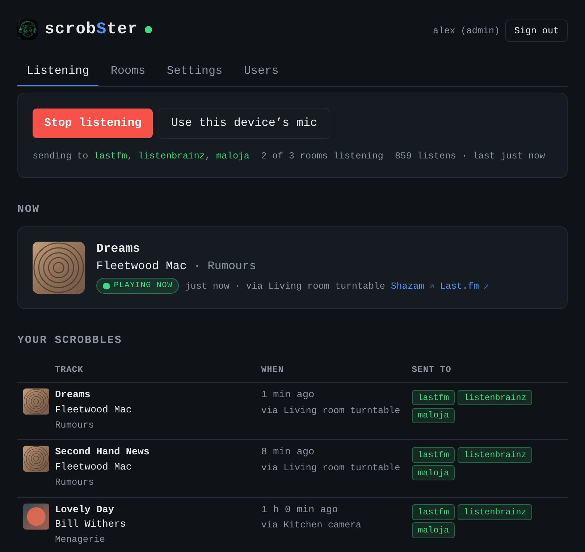
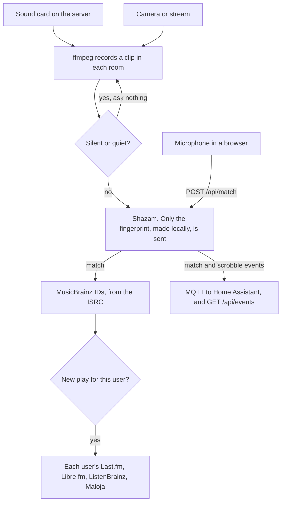

# scrobSter

[](https://artifacthub.io/packages/search?repo=scrobster)

Self-hosted background-audio scrobbler. It listens to audio inputs (a mic, a line-in, a USB turntable, or the audio of your security cameras), identifies songs with Shazam, and scrobbles them to Last.fm, Libre.fm, ListenBrainz, and Maloja. Point it at a radio, a TV, or every room in the house.



## Contents

On this page: [How it works](#how-it-works), [Requirements](#requirements),
[Quick start](#quick-start) and [Notes](#notes).

**Guides**, step by step

- **[Home Assistant](docs/guides/home-assistant.md)**: from adding the add-on
  repository to a room that scrobbles and a dashboard card.
- **[Kubernetes with Helm](docs/guides/kubernetes.md)**: secrets, storage,
  HTTPS for phones, and a sound card on one node.
- **[Proxmox VE](docs/guides/proxmox.md)**: a USB turntable passed through to a
  VM or an LXC container.
- **[A phone as the microphone](docs/guides/phone.md)**: HTTPS, permissions,
  and good matches on an iPhone or Android.

**Set up**

- **[Install](docs/install.md)**: [Docker](docs/install.md#docker-linux-host),
  a [systemd service](docs/install.md#run-as-a-service-systemd) or
  [Kubernetes with Helm](docs/install.md#kubernetes-helm).
- **[Rooms and cameras](docs/rooms.md)**: cameras, USB turntables,
  [finding your audio device](docs/rooms.md#find-your-audio-device) and the
  [two ways to listen](docs/rooms.md#two-ways-to-listen).
- **[Accounts and configuration](docs/configuration.md)**: accounts,
  [every environment variable](docs/configuration.md#configuration-environment-variables),
  [connecting Last.fm](docs/configuration.md#connect-lastfm) and cover art.
- **[Home Assistant](docs/home-assistant.md)**: the add-on and
  [devices over MQTT](docs/home-assistant.md#devices-over-mqtt).

**Reference**

- **[API](docs/api.md)**: every route, and a REST sensor for Home Assistant.
- **[Architecture](docs/architecture.md)**: diagrams of one room's cycle, and
  of rooms sharing the Shazam rate limit.
- **[Troubleshooting](docs/troubleshooting.md)**: what to check when nothing
  matches, and the
  [measured recognition limits](docs/troubleshooting.md#recognition-limits-measured).
- **[Releasing](docs/releasing.md)**: for maintainers, how a version is
  published and [verified](docs/releasing.md#verifying).

## How it works

Every 15 seconds, ffmpeg records a 12-second chunk in each room. A room is one
input: a microphone on the server, or a camera's RTSP or RTSPS stream. See
[Rooms and cameras](docs/rooms.md).
[shazamio](https://github.com/shazamio/shazamio) builds an audio signature
locally and asks the Shazam API for a match.

This is the whole path, from input to scrobble. [Architecture](docs/architecture.md)
shows one room's cycle, and how rooms share Shazam.



A match does two things. It marks the track as playing now, so your profile
shows the live "scrobbling now" line while the song continues. It also scrobbles
the track once per play. A track that keeps playing is not scrobbled again, but
a track that restarts is, because scrobSter compares the match offset. See
[Recognition limits](docs/troubleshooting.md#recognition-limits-measured).

When the music stops, the mark is removed. After `NOW_PLAYING_STOP_SECONDS` with
no match, scrobSter clears it, and it also clears it when you stop the listener.
ListenBrainz and Maloja are cleared through an API call. Last.fm has no method to
clear a mark, so its own copy disappears a few minutes later.

The default of 180 seconds is deliberate. Matches drop out during quiet
passages, so a shorter limit would make the mark flicker during a song.

A web page shows the current match and the history. The JSON API serves mobile
clients and Home Assistant.

Each person has an account and connects their own scrobbling services in
Settings. A room is shared, so every user chooses, room by room on the Rooms
tab, whether to receive what it hears. A microphone in a browser is different: that listen
belongs to the person who recorded it, and goes only to them.

## Requirements

- Python 3.10 - 3.13
- ffmpeg on PATH
- An audio input device

## Quick start

```sh
python3 -m venv .venv
.venv/bin/pip install -r requirements.txt
```

Put your settings in a `.env` file next to the code. Git ignores this file, and
your secrets stay out of the shell history.

```sh
# .env
AUDIO_DEVICE=:1
ADMIN_PASSWORD=choose-something-long
```

Then start it:

```sh
.venv/bin/python -m scrobster
```

A real environment variable always overrides the file, so Docker and systemd
work as usual.

Open http://localhost:8000 and sign in as `admin`. Connect your scrobbling
services under Settings.

Without `ADMIN_PASSWORD`, the first start makes a random password and writes it
to the log once. Read it there, then change it in Settings.

Toggle listening from the page.

Test recognition with a file first:

```sh
.venv/bin/python -m scrobster.listener some-song.wav
```

## Notes

- The Shazam API is unofficial and can change or block at any time. Keep `MATCH_INTERVAL` at 12 seconds or higher.
- Scrobbles fire at match time, not at track end. This is fine for radio.
- Run the logic self-check with `.venv/bin/python test_scrobster.py`.
- `requirements.txt` pins exact versions, so a rebuild cannot pull a shazamio that breaks matching. Dependabot opens weekly pull requests for the pins, the GitHub Actions and the base image; CI tests each one.
