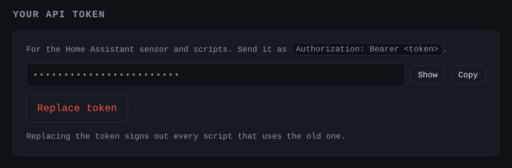

# API

Every route needs a signed-in session, a personal API token, or a request
through Home Assistant ingress.

| Endpoint | Purpose |
|---|---|
| `POST /api/login` `{username, password}` | sign in, sets a session cookie |
| `GET /api/status` | version, listening state, last match, profile links, and `rooms`: each room's state, level and last match, and `skipped`, the cycles that did not ask Shazam because the song was known, and `failing_since`, the unix time a room started failing, or `null`. `floor_db` is the last clip's median level, and `quiet` says it was below `QUIET_DBFS`. `level_db` and `last_error` describe the first room. `mqtt` says whether the broker is connected |
| `GET /api/events` | what happens, as it happens, as [server-sent events](https://developer.mozilla.org/docs/Web/API/Server-sent_events). Each event is named by its kind: `match`, `scrobble`, `cleared`, `listening`, `rooms`, `member`, `users`, `services`, `rates`. You see what the rest of the API would show you. `resync` means events were lost, so read `/api/status` again |
| `GET /api/levels` | `{room_id: dBFS}`: the live peak of each room that is listening, or `null` between two recordings |
| `POST /api/listen` `{"on": true}` | start or stop listening in every room that is turned on. Administrator only |
| `POST /api/match` (raw audio body) | identify one clip and scrobble it for the caller |
| `GET /api/recent?limit=50` | that user's scrobble history |
| `GET /api/me` | account details, with the rooms that scrobble for you |
| `GET /api/services`, `PUT/DELETE /api/services/{name}` | that user's service credentials |
| `GET /api/rooms` | the rooms. An administrator also sees each input, with a camera password masked |
| `POST /api/rooms`, `PUT/DELETE /api/rooms/{id}` `{name, kind, device, backend, url, enabled}` | add, change or remove a room. `kind` is `device` or `stream`. Administrator only |
| `PUT /api/rooms/{id}/member` `{"on": true}` | receive what that room hears, or stop |
| `GET/PUT/DELETE /api/recognition` `{gap, interval}` | how often Shazam is asked, with the request count of the last ten minutes. `DELETE` goes back to the environment. Administrator only |
| `GET /api/audio` | the devices ffmpeg can see, and the environment's default. Administrator only |
| `POST /api/audio/test` `{kind, device, backend, url, room_id}` | record three seconds and report the peak level. Administrator only |
| `GET/POST/DELETE /api/users` | accounts. Administrator only |

Home Assistant REST sensor, if you do not use MQTT. Copy the token from Settings:

```yaml
sensor:
  - platform: rest
    name: scrobSter
    resource: http://your-host:8000/api/status
    headers:
      Authorization: !secret scrobster_token
    value_template: "{{ value_json.last_match.title if value_json.last_match else 'none' }}"
    json_attributes: [listening, last_match, level_db]
    scan_interval: 30
```

Put `scrobster_token: Bearer your-token-here` in `secrets.yaml`.

The token is under Settings, hidden until you select Show:



For a sensor per room, such as "what is playing in the kitchen", use this
`value_template` instead:

```yaml
    value_template: >-
      
      {{ room.last_match.title if room and room.last_match else 'none' }}
```
