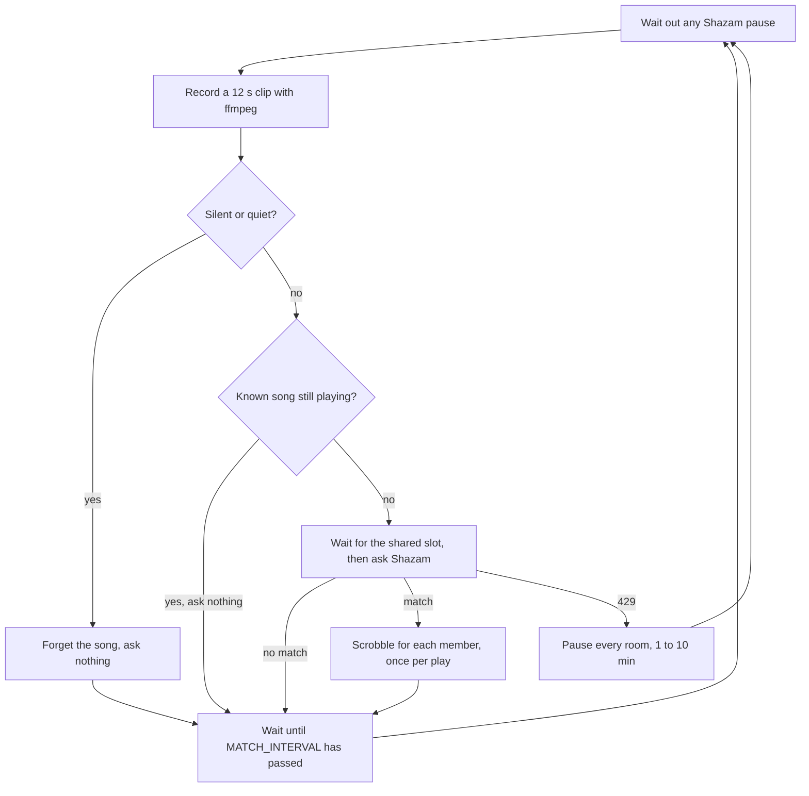
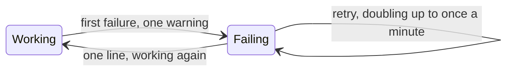
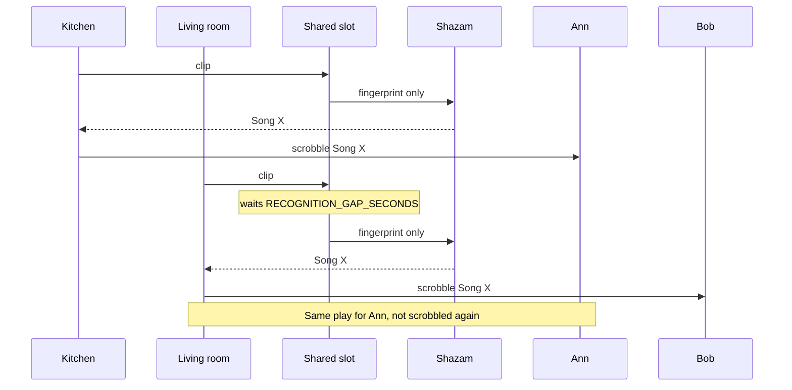

# How it works, in diagrams

The README's [How it works](../README.md#how-it-works) shows the whole path,
from input to scrobble. This page shows one room's cycle, a room that keeps
failing, and how rooms share Shazam. The code is in `scrobster/listener.py`.

## One room's cycle

Each room runs this loop on its own, once per `MATCH_INTERVAL`, 15 seconds by
default:

A clip is silent when its peak is below -70 dBFS, and quiet when its floor is
below `QUIET_DBFS`, if you set it. A song is known once the room matches it twice in a row. It stays
known until MusicBrainz says it should end, and for at most
`SKIP_KNOWN_SECONDS`. See [Rooms and cameras](rooms.md).

## A room that keeps failing

When a cycle fails, for example because a camera is offline, the room logs
once and then retries more slowly:

While it fails, the log gets a reminder every 15 minutes and a line for each
new reason. Over MQTT the room's **Problem** sensor is on.

## Rooms share one Shazam

Every room asks Shazam from the same address, so requests take turns. Each user
chooses the rooms that scrobble for them, and a song that two rooms hear at once
is one play for that user. Here Ann receives both rooms, and Bob only the
living room:

A 429 from Shazam pauses every room, for a minute at first and up to ten while
it lasts. A clip from a browser takes its turn in the same slot, and scrobbles
only for the person who recorded it.
