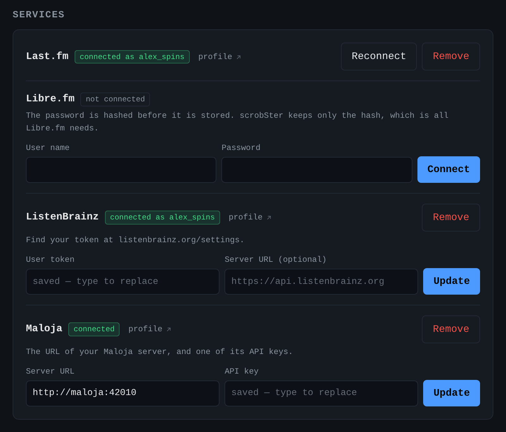
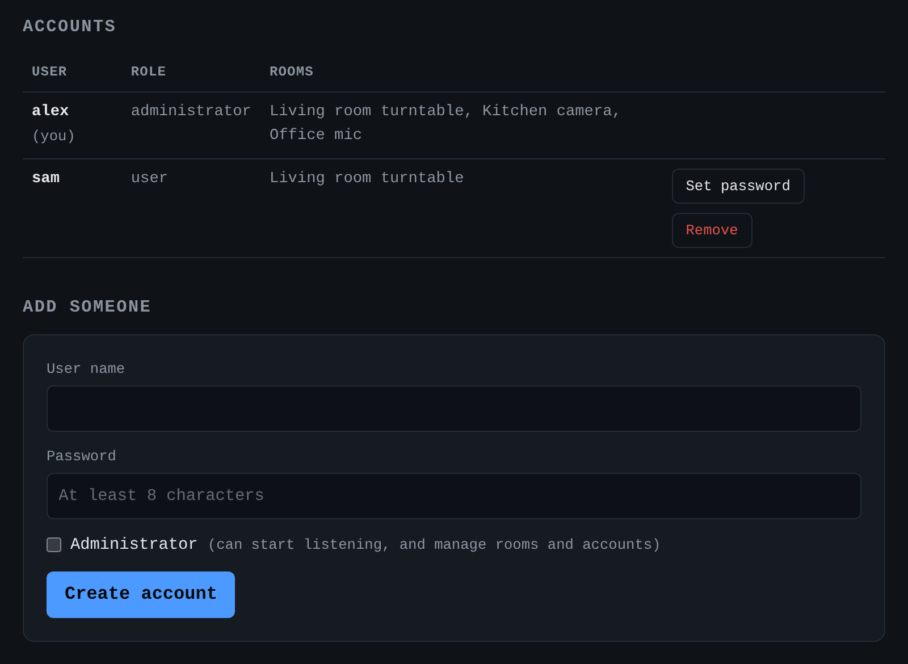

# Accounts and configuration

## Accounts

The first start creates one administrator. An administrator adds more accounts
under Users, and each person connects their own services.

- **Service credentials belong to a user** and are set in the web page. The
  variables below only seed the first account, on the very first start.
- **The Last.fm API key and secret stay in the environment.** They identify this
  application, not a person, so one registration serves everybody. Each user
  then authorizes Last.fm in the browser under Settings, which stores a session
  key for that user alone.
- **Only an administrator starts or stops listening**, and adds or changes rooms.
- **Each user gets an API token** in Settings, for Home Assistant and scripts.
- **A display gets a display token**, which only reads what the rooms play. See
  [Displays](#displays).

## Displays

A tablet, a Raspberry Pi with a screen, an ESP32 with an LCD, or a Home
Assistant dashboard can show the cover of what a room plays. An administrator
makes a link for it under Settings, Displays, or with a room's Display button
on the Rooms tab. Give it a name, such as "Living room tablet", and choose a
room. The page shows two links, once:

- **Display page**, `/display?room=1&token=...`, a full-screen cover with the
  title and artist, for a browser. Add `&idle=blank` for a black screen instead
  of a clock while nothing plays.
- **Cover image**, `/api/rooms/1/cover?size=480&idle=image&token=...`, the
  picture alone, for ESPHome or a Home Assistant image.

The token can read what the rooms play, and nothing else: no history, no
accounts, no settings, no camera URLs. It still goes in a URL, so revoke it in
the same list when a screen goes away. Only its hash is kept, so a lost one
cannot be shown again: make a new one. [The API](api.md#displays) lists every
option.

Each person connects their services under Settings. A secret is never shown
again once saved:



An administrator adds people under Users, and sees which rooms scrobble for
each of them:



## Configuration (environment variables)

A service is enabled when all of its variables are set.

| Variable | Default | Purpose |
|---|---|---|
| `AUDIO_BACKEND` | `avfoundation` (macOS) / `alsa` (Linux) | ffmpeg input format |
| `AUDIO_DEVICE` | `:0` (macOS) / `default` (Linux) | ffmpeg input device for a microphone room that names no device of its own, the first room included |
| `CHUNK_SECONDS` | `12` | recorded seconds per match attempt; values above 14 are capped |
| `MATCH_INTERVAL` | `15` | minimum seconds per cycle in each room, 12 to 600; increase if rate-limited. The Rooms tab can change it |
| `RECOGNITION_GAP_SECONDS` | `4` | minimum seconds between two Shazam requests, across every room and browser clip, 1 to 60. The Rooms tab can change it |
| `SKIP_KNOWN_SECONDS` | `60` | while a room hears a song it matched twice, skip Shazam for up to this long, or until the song should end. `0` asks every cycle |
| `RESCROBBLE_MINUTES` | `30` | fallback cooldown, used only when a match has no offset |
| `NOW_PLAYING_STOP_SECONDS` | `180` | clear the playing-now mark after this long with no match |
| `QUIET_DBFS` | unset | a clip whose floor, its median level with clicks and pops ignored, is below this counts as silence. For a turntable, try `-50`. Unset, only a peak below -70 dBFS is silence. See [Troubleshooting](troubleshooting.md#troubleshooting) |
| `DB_PATH` | `scrobster.db` | SQLite history file |
| `PORT` | `8000` | web/API port |
| `ADMIN_USERNAME` | `admin` | name of the account made on the first start |
| `ADMIN_PASSWORD` | unset | its password. Without one, a random password is logged once |
| `TRUST_INGRESS` | `1` | treat Home Assistant ingress requests as the owner, with no second sign-in |
| `INGRESS_IP` | `172.30.32.2` | the address ingress requests come from |
| `API_TOKEN` | unset | optional shared token that acts as the owner. Each user also has a personal token |
| `LISTEN_ON_START` | `1` | start listening in every room that is turned on at boot |
| `LASTFM_API_KEY` `LASTFM_API_SECRET` | unset | identifies this application to Last.fm, for every user. Create a key at https://www.last.fm/api/account/create |
| `MQTT_ENABLED` | `auto` | Home Assistant devices over MQTT. `auto` connects when `MQTT_HOST` is set or the Supervisor offers a broker. `0` turns it off. See [Home Assistant](home-assistant.md) |
| `MQTT_HOST` `MQTT_PORT` | unset, `1883` | the broker |
| `MQTT_USERNAME` `MQTT_PASSWORD` | unset | its credentials |
| `MQTT_TLS` | `0` | connect with TLS |
| `MQTT_TOPIC` | `scrobster` | where states and commands go, under `<topic>/<instance>/` |
| `MQTT_DISCOVERY_PREFIX` | `homeassistant` | Home Assistant's discovery prefix |

These seed the first account only. After that, each user manages their own under
Settings.

| Variable | Purpose |
|---|---|
| `LISTENBRAINZ_TOKEN`, `LISTENBRAINZ_URL` | ListenBrainz |
| `LASTFM_SESSION_KEY`, `LASTFM_USERNAME` | Last.fm, or authorize in the browser instead |
| `LASTFM_PASSWORD_HASH` or `LASTFM_PASSWORD` | Last.fm without the browser step |
| `LIBREFM_USERNAME` + `LIBREFM_PASSWORD` or `LIBREFM_PASSWORD_HASH` | Libre.fm. A password is hashed on the first start and only the hash is kept |
| `MALOJA_URL`, `MALOJA_KEY` | Maloja |

## Connect Last.fm

Create an API account at https://www.last.fm/api/account/create. Put the key and
the secret in `.env`, then authorize once:

```sh
.venv/bin/python -m scrobster.auth          # prints a URL, open it and allow access
.venv/bin/python -m scrobster.auth <token>  # prints LASTFM_SESSION_KEY
```

Copy the session key into `.env`. scrobSter never stores your password. You can
revoke the key in your Last.fm account settings.

## Cover art and MusicBrainz IDs

Shazam returns a cover and usually an ISRC with each match. scrobSter uses both
where a service can take them:

- **ListenBrainz and Maloja** receive MusicBrainz IDs in `additional_info`.
  scrobSter finds them from the ISRC, once per track. ListenBrainz uses the
  release ID to show that release's cover from the Cover Art Archive. A release
  ID is sent only when a release title matches Shazam's album, because a wrong
  release would show the wrong cover.
- **Maloja** receives Shazam's cover as an uploaded picture, for an album that
  Maloja shows a placeholder for. It never replaces a picture Maloja already
  has, and it tries each album once per run.
- **Last.fm and Libre.fm** receive neither. Their API has no artwork upload, so
  missing Last.fm art still has to be added by hand on the album page.

All of this is best effort. If MusicBrainz or Maloja fails, the scrobble still
goes through without it.
