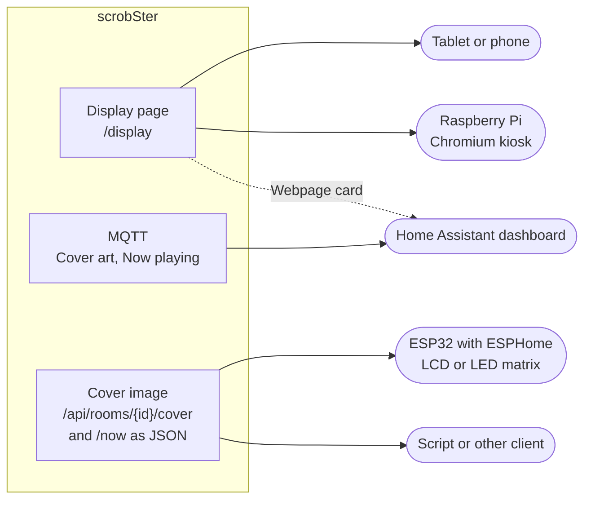

# A display by the hi-fi

A screen next to the record player can show what the room plays: the cover,
the title and the artist. This page has a recipe for each kind of screen.

| Your screen | Use | Recipe |
|---|---|---|
| An old tablet or phone | the display page in its browser | [Old tablet or phone](#an-old-tablet-or-phone) |
| A Raspberry Pi with an HDMI screen or a touchscreen | the display page in Chromium, in kiosk mode | [Raspberry Pi](#a-raspberry-pi-in-kiosk-mode) |
| A Home Assistant dashboard, on a wall tablet or anywhere | the MQTT Cover art entity, or the display page in a card | [Home Assistant](#a-home-assistant-dashboard) |
| An ESP32 with a small LCD, or a 64×64 LED matrix | the cover image, with ESPHome | [ESPHome](#esphome-on-an-esp32) |
| Anything else: an e-ink frame, a script, a smart speaker with a screen | the JSON and the cover image | [Any other client](#any-other-client-or-script) |



## Make a display token

Every recipe starts with a display token. An administrator makes one under
**Settings**, **Displays**, or with a room's **Display** button on the Rooms
tab. Name it after the screen, such as "Living room tablet", and choose a room,
or **Whichever room plays**. See [Displays](configuration.md#displays).

The page shows two links, once:

- **Display page**, such as
  `https://scrobster.example.com/display?room=1&token=display-...`, for a
  browser.
- **Cover image**, such as
  `https://scrobster.example.com/api/rooms/1/cover?size=480&idle=image&token=display-...`,
  for ESPHome or anything else that shows a picture.

Copy them now. Only the token's hash is kept, so a lost token cannot be shown
again. Make a new one instead.

Without a room, the links are `/display?token=...` and `/api/cover?...`: they
follow whichever room matched last.

**What a display token can do.** It reads what the rooms play: each room's
name, the song, and the cover. Nothing else: no history, no accounts, no
settings, no camera URLs. It sends nothing, unless it is a room token, see
[the tablet as the microphone](#also-the-rooms-microphone). Revoke it under
Settings, Displays when a screen goes away. See [Security](../SECURITY.md).

**Use HTTPS where you can.** The token is in the URL, so anyone who sees the
traffic on a plain `http://` address can read it. A browser also keeps the
screen on, and gives a page the microphone, only over HTTPS. The
[phone guide](guides/phone.md#step-1-put-the-page-behind-https) shows four ways
to get it: Tailscale, a Cloudflare Tunnel, a reverse proxy or Home Assistant.
On your own network, plain `http://` still shows the cover.

**Cloudflare Access** puts Cloudflare's sign-in in front of every path. A
display cannot sign in to it. Leave Access off `/display`, `/api/now`,
`/api/cover`, `/api/events` and `/api/rooms/`, and `/mic.js` for a tablet that
listens, or give a client that can send headers an Access service token. See
[Cloudflare Tunnel](guides/phone.md#cloudflare-tunnel).

## An old tablet or phone

1. Open the **Display page** link in the tablet's browser.
2. Tap the screen once. Where the browser allows it, the page goes full
   screen and asks to keep the screen on.

While nothing plays, the page shows a clock. Add `&idle=blank` for a black
screen instead:

```text
https://scrobster.example.com/display?room=1&idle=blank&token=display-...
```

`idle` is `clock`, the default, or `blank`. Without `room`, the page shows
whichever room matched last.

Make it a kiosk:

- **iPhone or iPad.** In Safari, choose Share, then **Add to Home Screen**.
  The page opens from there with no address bar. Turn on **Guided Access**
  under Settings, Accessibility, then triple-click the side or home button to
  lock the tablet to the page. Set Auto-Lock to Never under Settings, Display
  & Brightness.
- **Android.** Use **Add to Home screen** in Chrome. Turn on **App pinning**
  (also called screen pinning) under Settings, Security, and pin Chrome. Under
  Developer options, **Stay awake** keeps the screen on while it charges.

Keep it running:

- **Plug it in.** If the tablet can stop charging at 80 %, turn that on: a
  battery that sits at 100 % for months can swell.
- **Burn-in.** The page moves everything by a few pixels each minute, and the
  clock further. On an OLED screen, `&idle=blank` is safer still.
- **Old tablets work.** The page needs nothing newer than Safari 10.

The page also takes on the cover's main colour: a soft glow behind the words,
and around the cover. A black and white cover leaves the page as it is. The
same colour is in the JSON as `colors`, see [Any other client](#any-other-client-or-script),
and in Home Assistant as each room's Cover colour, which can set a lamp to
match the record: see [Match a light to the cover](home-assistant.md#match-a-light-to-the-cover).

### Also the room's microphone

A tablet can also be the room's microphone, so the room needs no microphone
on the server. Add a room that listens through **A browser in the room**,
press its **Display** button and keep **Use this browser as the room's
microphone** ticked. The link then ends in `&listen=1`, and its token is a room
token: it reads that room only, and sends what the tablet hears to that room.
This needs HTTPS. See
[A tablet as the room's microphone](rooms.md#a-tablet-as-the-rooms-microphone).

## A Raspberry Pi in kiosk mode

A Raspberry Pi 3, 4 or 5 with an HDMI screen or the official touchscreen can
show the display page full screen from boot. These steps are for Raspberry Pi
OS with the desktop, which uses the labwc Wayland compositor on a Pi 4 or 5.

Not verified: these steps on a real Pi. Check the paths against your release.

1. Turn off screen blanking:

   ```sh
   sudo raspi-config nonint do_blanking 1
   ```

   Or choose **Display Options**, **Screen Blanking**, **No** in
   `sudo raspi-config`.
2. Start Chromium in kiosk mode at login. Add one line to
   `~/.config/labwc/autostart`, with your display page link in quotes:

   ```sh
   mkdir -p ~/.config/labwc
   echo 'chromium --kiosk --noerrdialogs --disable-infobars --no-first-run "https://scrobster.example.com/display?room=1&token=display-..." &' >> ~/.config/labwc/autostart
   ```

   On Raspberry Pi OS Bookworm the program is `chromium-browser`. Run
   `which chromium chromium-browser` to see which one you have. A file of
   your own in `~/.config/labwc` may be read instead of the desktop's, and
   then the taskbar does not start. A kiosk does not need it.
3. Make the Pi sign in by itself: **System Options**, **Boot / Auto Login**,
   **Desktop Autologin** in `sudo raspi-config`.
4. Reboot.

The page hides the mouse pointer after three seconds without movement, so a
mouse left on the desk does no harm. To leave kiosk mode, plug in a keyboard
and press Alt+F4.

Without HTTPS, the page still shows the cover. Blanking is already off, so the
screen stays on without the browser's help.

## A Home Assistant dashboard

With MQTT, each room is a device in Home Assistant. Two of its entities are
for a display. See [Devices over MQTT](home-assistant.md#devices-over-mqtt).

- **Cover art**, an image entity, such as `image.scrobster_living_room_cover_art`.
  It appears after the room's first match.
- **Now playing**, a sensor, such as `sensor.scrobster_living_room_now_playing`.
  Its state is `Artist - Title`, or `idle`. Its attributes are the last track:
  `artist`, `title`, `album`, `art_url`, `ts`, `room` and more.

Home Assistant builds the entity IDs from the names. Check yours on the
device page, under **Settings**, **Devices & services**, **MQTT**, and
replace `living_room` below.

Not verified: these cards in a running dashboard.

**The cover, large.** Edit a dashboard, add a card, choose **Manual**, and
paste:

```yaml
type: picture-entity
entity: image.scrobster_living_room_cover_art
show_name: false
show_state: false
```

The Cover art entity goes unavailable when the record stops, so a stale cover
never shows. To hide the card then, wrap it in a conditional card; see
[Cover art for a display](home-assistant.md#cover-art-for-a-display).

**The cover with the words.** A Markdown card reads the sensor's attributes.
It shows nothing but "Nothing playing" while the room is idle:

```yaml
type: markdown
content: >-
  
  
  

  ## {{ state_attr(s, 'title') }}
  {{ state_attr(s, 'artist') }} · {{ state_attr(s, 'album') }}
  
  Nothing playing
  
```

The cover comes from Apple's servers, as Shazam gave it, so the browser
showing the dashboard needs the internet.

**The whole display page.** A Webpage card shows the display page, clock and
all:

```yaml
type: iframe
url: https://scrobster.example.com/display?room=1&token=display-...
aspect_ratio: 100%
```

A dashboard opened over `https` shows only an `https` page in a card. A
browser blocks an `http://` page there as mixed content.

**React to a song.** The room's **Match** event fires when it starts hearing a
song, for an automation that turns the screen on. See the example in
[Devices over MQTT](home-assistant.md#devices-over-mqtt).

## ESPHome on an ESP32

ESPHome downloads the cover image and draws it. Two examples follow: an
ILI9341 or ST7789 LCD, and a 64×64 HUB75 LED matrix.

Not verified: these configurations on hardware. Each one passes
`esphome config` with ESPHome 2026.10.1. Pins differ from board to board, so
check yours.

Things to know first:

- **Use `idle=image`.** While nothing plays, the cover route then answers with
  a black square of the same size. With the default `idle=204`, ESPHome counts
  the empty answer as an error and keeps showing the last cover.
- **The image is always a JPEG.** Shazam's covers are JPEGs, and so is the
  black idle square, so `format: jpeg` fits both.
- **Ask for the size you show.** `size` is 32 to 1200 pixels square, and
  Apple's covers are fetched at that size. `resize` makes sure of it.
- **Asking often is cheap.** Each answer carries an `ETag`. ESPHome sends it
  back, and while the song is the same the answer is a `304` with no image.
- **An ESP32 cannot join a tailnet.** Use the server's address on your network,
  such as `http://192.168.1.20:8000`, or a public HTTPS name, such as a
  Cloudflare Tunnel without Access on `/api/rooms/`.
- **Memory.** A 240×240 cover in RGB565 is 115 kB, more than an ESP32 has to
  spare beside a screen buffer. Use a board with PSRAM, such as an ESP32-S3.

Put the cover link in `secrets.yaml`, so the token stays out of the
configuration:

```yaml
scrobster_cover_url: "https://scrobster.example.com/api/rooms/1/cover?size=240&idle=image&token=display-..."
```

### An LCD: ILI9341 or ST7789

This is for an ESP32-S3 with 8 MB of octal PSRAM and a 320×240 ILI9341 on SPI.
The cover fills the middle 240×240 pixels.

```yaml
esphome:
  name: hifi-cover

esp32:
  board: esp32-s3-devkitc-1
  framework:
    type: esp-idf

psram:
  mode: octal

wifi:
  ssid: !secret wifi_ssid
  password: !secret wifi_password

logger:

http_request:
  timeout: 10s

spi:
  clk_pin: GPIO12
  mosi_pin: GPIO11

image:
  - platform: online_image
    id: cover
    url: !secret scrobster_cover_url
    format: jpeg
    type: rgb565
    resize: 240x240
    on_download_finished:
      - component.update: screen
    on_error:
      - logger.log: "No cover this time; the last one stays"

interval:
  - interval: 15s
    then:
      - component.update: cover

display:
  - platform: ili9xxx
    id: screen
    model: ILI9341
    cs_pin: GPIO10
    dc_pin: GPIO9
    reset_pin: GPIO8
    invert_colors: false
    dimensions:
      width: 320
      height: 240
    update_interval: never
    lambda: |-
      it.fill(Color::BLACK);
      it.image(40, 0, id(cover));
```

For a 240×240 ST7789, change the display to `model: ST7789V`, with
`invert_colors: true` and `dimensions` of 240 by 240, and draw the cover at
`it.image(0, 0, id(cover));`. Many ST7789 boards need the colours inverted.

Every 15 seconds the `interval` asks for the cover again. A new song shows
within 15 seconds of its match, and an unchanged one costs a `304`. Once a
download finishes, `on_download_finished` redraws the screen.

Older ESPHome releases have `online_image:` as a component of its own, with
the same options. There, write `online_image:` with the same entry and no
`platform:` line. ESPHome 2026.10 still reads that form, with a warning.

### A 64×64 LED matrix

A HUB75 RGB matrix shows a 64×64 cover bright enough to read across the room.
ESPHome 2026.10 has a `hub75` display built in, with presets for boards such
as the Adafruit Matrix Portal S3. An older ESPHome needs an external
component instead, such as
[ESPHome-HUB75-MatrixDisplayWrapper](https://github.com/TillFleisch/ESPHome-HUB75-MatrixDisplayWrapper),
whose options differ.

Ask for `size=64` in the link:

```yaml
scrobster_matrix_url: "https://scrobster.example.com/api/rooms/1/cover?size=64&idle=image&token=display-..."
```

```yaml
esphome:
  name: hifi-matrix

esp32:
  board: adafruit_matrixportal_esp32s3
  framework:
    type: esp-idf

psram:
  mode: quad

wifi:
  ssid: !secret wifi_ssid
  password: !secret wifi_password

logger:

http_request:
  timeout: 10s

image:
  - platform: online_image
    id: cover
    url: !secret scrobster_matrix_url
    format: jpeg
    type: rgb565
    resize: 64x64
    on_download_finished:
      - component.update: matrix

interval:
  - interval: 15s
    then:
      - component.update: cover

display:
  - platform: hub75
    id: matrix
    board: adafruit-matrix-portal-s3
    panel_width: 64
    panel_height: 64
    brightness: 96
    update_interval: never
    lambda: |-
      it.image(0, 0, id(cover));
```

A matrix is bright in a dark room. Lower `brightness`, from 0 to 255.

## Any other client or script

Two routes are enough for anything else. Both take the display token as
`Authorization: Bearer <token>`, or as `?token=` for a client that cannot set
a header. [The API](api.md#displays) lists every option.

**What plays**, as JSON:

```sh
curl -H "Authorization: Bearer display-..." \
  https://scrobster.example.com/api/rooms/1/now
```

```json
{"room_id": 1, "room": "Living room", "playing": true,
 "artist": "Fleetwood Mac", "title": "Dreams", "album": "Rumours",
 "since": 1761950000, "heard": 1761950090,
 "art": "/api/rooms/1/cover", "art_key": "3f2a9c1b7d04",
 "colors": {"primary": {"rgb": [255, 197, 143], "hex": "#ffc58f"},
            "secondary": null, "brightness": 199, "saturated": false}}
```

While nothing plays, `playing` is `false` and the song fields are `null`.
`art_key` changes with the cover, so a client fetches the image again only
when it changes. `/api/now` answers the same for whichever room matched last.

`colors` is the cover's main colour, for an LED strip or a backlight:
`primary`, the most common colour on the cover that a light can show,
`secondary`, another that looks different, or `null`, and `brightness`, 0 to
255, as light as the primary is on the cover. A cover with no such colour,
such as Rumours' black and white photo, gives a warm white with
`saturated: false`, as above.
`colors` is `null` while nothing plays, and for the first second or so of a
song, while the colours are worked out; the `colors` event says when they are
ready.

**The cover**, as an image:

```sh
curl -o cover.jpg -H "Authorization: Bearer display-..." \
  "https://scrobster.example.com/api/rooms/1/cover?size=600&idle=image"
```

`idle` says what the route answers while nothing plays: `204` (the default),
`404`, or `image`, a black JPEG of `size` pixels. Send the `ETag` back as
`If-None-Match`, and the answer is a `304` while the cover is the same.

**As it happens.** Instead of asking every few seconds, follow the event
stream:

```sh
curl -N -H "Authorization: Bearer display-..." \
  https://scrobster.example.com/api/events
```

A display token sees `hello` when it connects, `match` with the `room_id` each
time a room matches, `colors` with the `room_id` when the colours of its cover
are ready, `rooms` and `listening` when those change, and `resync` when events
were lost. Read `now` again on each one. A song that stops sends
no event, so also read `now` every 20 seconds or so, as the display page does.

## When something goes wrong

**The page says "This display link no longer works", or a client gets `401`.**
The token was revoked, or it was a room token and its room was removed. Make
a new one under Settings, Displays.

**A client gets `403`.** It holds a room token, and asks for another room.
A room token reads its own room only.

**The screen is black.** Nothing plays, and you chose `idle=blank` or
`idle=image`. A room stops playing after `NOW_PLAYING_STOP_SECONDS` without a
match, after a silent clip, or when it stops listening. Check the room on the
Rooms tab: is it listening, and does it match?

**The cover does not change.**

- On ESPHome, check the log for `HTTP result`. Without `idle=image` in the
  link, a `204` keeps the last cover.
- In Home Assistant, the Cover art entity goes unavailable
  `NOW_PLAYING_STOP_SECONDS` after the last match, not the moment a side
  ends. Lower that setting for a quicker change, or use the display page,
  which goes idle on the first silent clip.
- The room may still hear the last song. While a room hears a song it knows,
  it waits up to `SKIP_KNOWN_SECONDS` before asking Shazam again.

**The tablet's screen turns off, or the microphone is refused.** A browser
keeps the screen on, and gives a page the microphone, only over HTTPS. Open
the link over `https`, or use the tablet's own setting to stay awake. See
[the phone guide](guides/phone.md#step-1-put-the-page-behind-https).

**The display shows a Cloudflare sign-in page, or ESPHome logs a `302` or
`403`.** Cloudflare Access is in front of the display routes. Leave Access off
`/display`, `/api/now`, `/api/cover`, `/api/events` and `/api/rooms/`. See
[Cloudflare Tunnel](guides/phone.md#cloudflare-tunnel).
