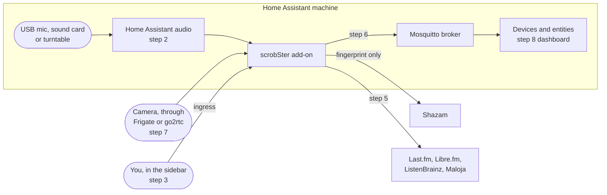

# Get started with Home Assistant

This guide takes you from nothing to a room that scrobbles, with its song on a
Home Assistant dashboard. It uses the scrobSter add-on from
[benkelly/ha-addons](https://github.com/benkelly/ha-addons), which runs the same
image as every other install.

For the reference behind each step, see [Home Assistant](../home-assistant.md),
[Rooms and cameras](../rooms.md) and
[Accounts and configuration](../configuration.md). The add-on's own
documentation, shown on its **Documentation** tab, lists every option.

> [!NOTE]
> The steps were written from the add-on's `config.yaml` and from scrobSter's
> code, not by clicking through a running Home Assistant. Menu names can differ
> a little between Home Assistant versions. Anything that was not checked is
> marked **Not verified**.

## What you need

- **Home Assistant OS, or a Supervised install.** Add-ons need the Supervisor.
  A Home Assistant Container or Core install has no add-ons; run the
  [Docker image](../install.md) next to it instead.
- **A 64-bit machine**: `amd64` or `aarch64`, for example a Raspberry Pi 4 or 5
  running the 64-bit OS. The add-on is not built for 32-bit ARM.
- **An input**, plugged into the Home Assistant machine: a USB microphone, a
  USB sound card with a line input, or a USB turntable. A camera with audio
  works too, and needs no cable.
- **An account to scrobble to**: Last.fm, Libre.fm, ListenBrainz or Maloja. A
  ListenBrainz token is the quickest.
- **Optional, for devices and entities**: the Mosquitto broker add-on. Step 6
  installs it.

This is what the steps connect:



## 1. Add the repository

The quickest way is this link. It opens your Home Assistant and fills in the
repository for you:

[Add the repository to my Home Assistant](https://my.home-assistant.io/redirect/supervisor_add_addon_repository/?repository_url=https%3A%2F%2Fgithub.com%2Fbenkelly%2Fha-addons)

The first time, the link asks for your Home Assistant address. Confirm the
dialog that opens.

To add it by hand:

1. Open **Settings** > **Add-ons** > **Add-on Store**.
2. Open the menu at the top right, and choose **Repositories**.
3. Paste `https://github.com/benkelly/ha-addons` and select **Add**.
4. Close the dialog. The store lists the repository's add-ons near the bottom.

## 2. Install and configure the add-on

1. In the **Add-on Store**, select **scrobSter**, then **Install**. The image is
   pre-built, so nothing is compiled on your machine. Do not start it yet.
2. Open the **Configuration** tab.

### Choose the input

This is the setting that decides whether anything matches.

1. Plug your USB microphone, sound card or turntable into the Home Assistant
   machine.
2. On the **Configuration** tab, find the **Audio** section.
3. Choose your device under **Input**, and save.

Leave the two audio options as they are:

| Option | Leave it at | Why |
|---|---|---|
| `audio_backend` | `pulse` | Home Assistant provides its audio through PulseAudio. The **Input** you chose only applies to `pulse` |
| `audio_device` | `default` | `default` follows the **Input** you chose. A PulseAudio source name also works, but you rarely need one |

Step 4 checks that the input really hears music, and lets you pick a different
one per room.

### Set the other options

You can start with only these. The rest have sensible defaults.

| Option | Default | What to set |
|---|---|---|
| `admin_username` | `admin` | The first account. You rarely need it, see step 3 |
| `admin_password` | empty | A password for that account. Only needed to sign in another way than the sidebar. It is applied on every start, so it also recovers a lost password |
| `listenbrainz_token` | empty | Your token from <https://listenbrainz.org/settings/>, if you use ListenBrainz |
| `mqtt_enabled` | on | Leave it on for step 6 |

Service options only seed the first account on its very first start. After
that you manage services in the web page, in step 5. So you can leave them all
empty now.

The other options tune recognition: `match_interval`, `chunk_seconds`,
`recognition_gap_seconds`, `skip_known_seconds`, `rescrobble_minutes` and
`now_playing_stop_seconds`. The add-on's **Documentation** tab explains each
one. Leave them at their defaults to begin with.

Leave `api_token` empty while you use only the sidebar. With a token set, the
built-in page asks for it.

Save the configuration.

## 3. Start it and open it from the sidebar

1. On the **Info** tab, turn on **Show in sidebar**, then select **Start**.
2. Open the **Log** tab. A healthy start shows no tracebacks. Without a broker
   yet, it also warns once that no MQTT broker was found. That is expected until
   step 6.
3. Select **scrobSter** in the sidebar, or **Open Web UI** on the **Info** tab.

The page opens with no sign-in. Home Assistant has already signed you in, and
it passes the request through ingress, so scrobSter treats it as its owner, the
administrator. Home Assistant shows an add-on's sidebar panel only to its own
administrators by default.

`admin_password` matters only when you reach scrobSter another way, such as a
mapped port or a reverse proxy. Without one, a random password is written to
the log once, on the first start.

## 4. Check the level and pick the device

1. Open the **Rooms** tab. The first room is called **Server mic**, and it uses
   the **Input** from step 2.
2. Play music near the microphone, or play a record.
3. Read the room's level.

| Level while music plays | Meaning |
|---|---|
| About -20 dBFS | Healthy |
| About -91 dBFS | The input is silent. It is the wrong device |

To pick another device, select **Edit** on the room. The form lists the
devices ffmpeg can see. **Test level** records three seconds from the one you
pick and reports the peak, so a silent device is caught before you save it.


Rename **Server mic** after the room it is in, for example `Living room`. In
step 6 the room's device lands in the Home Assistant area with the same name.

**A USB turntable** is the best input for vinyl. Plug it into the Home
Assistant machine. It appears as a sound card, so choose it under **Input** in
step 2, or pick it in the room form. Use **Test level** while a record plays.
Near -20 dB is typical; near -91 dB means the wrong card, or the turntable is
set to Bluetooth. See [Rooms and cameras](../rooms.md) for wiring a turntable
or hi-fi without USB.

Not verified: how each USB device is named in the **Input** list and in the
room form. That comes from Home Assistant's audio system and your hardware.

## 5. Connect your services

Each person connects their own services in the web page.

1. Open **Settings** in the scrobSter page.
2. Connect ListenBrainz, Libre.fm or Maloja by filling in their fields.
3. For Last.fm, see below.

Every match goes to all the services you connect. The history shows a badge per
service for every scrobble, so you can see which one accepted it.

**Last.fm** needs an API key. The key identifies scrobSter itself, so one key
serves everybody on the add-on.

1. Create an API account at <https://www.last.fm/api/account/create>.
2. Put the key in `lastfm_api_key` and the secret in `lastfm_api_secret` on the
   add-on **Configuration** tab. Restart the add-on.
3. In the scrobSter page, open **Settings** and select **Connect** beside
   Last.fm.
4. Approve scrobSter in the tab that opens, then select **I approved it**.

Every user repeats steps 3 and 4 for their own account. scrobSter never stores
the Last.fm password.

To add more people, open **Users** as the administrator. Each person then turns
on **scrobble for me** on the **Rooms** tab, for the rooms they want. A room
scrobbles for nobody until then, except the administrator who added it.

See [Accounts and configuration](../configuration.md) for the details.

## 6. See it in Home Assistant, with MQTT

scrobSter publishes every room and every user as a device, through MQTT
discovery. The add-on gets the broker and its login from the Supervisor, so
there is nothing to type.

1. Open **Settings** > **Add-ons** > **Add-on Store**, and install
   **Mosquitto broker** from the official add-ons. Start it.
2. Home Assistant offers to set up the **MQTT** integration, under
   **Settings** > **Devices & services**. Select **Configure**, then
   **Submit**.
3. Restart scrobSter. The log says `MQTT: connected to ...`. Without a restart,
   scrobSter also notices the new broker by itself within five minutes.
4. Open **Settings** > **Devices & services** > **MQTT**. You see a
   **scrobSter** device, one device per room, and one per user.

| Device | Some of its entities |
|---|---|
| **scrobSter** | **Listening**, a switch for every room |
| **scrobSter Living room**, one per room | **Now playing**, **Cover art**, **Music**, **Input level**, **Problem**, **Match** event |
| **scrobSter admin**, one per user | **Last scrobble**, **Scrobbles today**, a **Scrobble** switch per room |

The full list, automations, and who can control what are in
[Home Assistant](../home-assistant.md).

Keep the broker private. Its switches act like an administrator. The Mosquitto
add-on accepts only Home Assistant users and add-ons. To publish nothing, turn
off `mqtt_enabled`.

## 7. Add cameras (optional)

A camera with its audio turned on is a room of its own. scrobSter asks the
camera for its audio only, so no video is downloaded.

1. Open **Rooms** in the scrobSter page, and fill in **Add a room**.
2. Give it a name, for example `Kitchen`.
3. Under **Listens through**, choose **A camera or stream**.
4. Paste the camera's URL.
5. Select **Test level**. A camera that hears sound reports a peak. A camera
   with its audio off says so.
6. Select **Add room**.

If you run **Frigate** or **go2rtc**, use its restream rather than the camera
itself. Many cameras accept only a few connections at once. A go2rtc or Frigate
restream looks like `rtsp://<host>:8554/<camera>`, for example
`rtsp://homeassistant.local:8554/kitchen`. **UniFi Protect** shares an RTSPS
URL per camera, on port 7441.

Not verified: the exact host name that reaches your Frigate or go2rtc from
inside the scrobSter add-on. Port 8554 must be reachable from the add-on, and
the stream must carry audio. Use **Test level** to check; if it fails, try the
IP address of the machine that runs Frigate or go2rtc.

Choose AAC at 16 kHz or more in the camera if you can. G.711 at 8 kHz matches
less often. The camera password stays in the add-on and is shown as `***`. See
[Rooms and cameras](../rooms.md) for more.

## 8. Put it on a dashboard

The room's **Now playing** sensor holds `Artist - Title`, or `idle`, with the
track as attributes. Its **Cover art** is an image entity.

Edit a dashboard, add a card, choose **Manual**, and paste this. Replace
`living_room` with your room's name, as Home Assistant spells it in entity IDs:

```yaml
type: vertical-stack
cards:
  - type: picture-entity
    entity: image.scrobster_living_room_cover_art
    name: Living room
    show_state: false
  - type: entities
    entities:
      - entity: sensor.scrobster_living_room_now_playing
        name: Now playing
      - entity: binary_sensor.scrobster_living_room_music
        name: Music
      - entity: sensor.scrobster_living_room_input_level
        name: Input level
```

Not verified: the entity IDs. Home Assistant builds them from the device and
entity names, so `scrobSter Living room` with **Now playing** should become
`sensor.scrobster_living_room_now_playing`. Check yours on the device page, under
**Settings** > **Devices & services** > **MQTT**. The **Cover art** entity
appears after the room's first match, because scrobSter sends no cover until
it has one.

Not verified: the card layout in a running dashboard.

## 9. Use your phone's microphone (optional)

The scrobSter page has a **Use this device's mic** button. It records from the
browser instead of the add-on, which is useful from a phone in a room with no
microphone. The phone's clips go to the same history, and only to the person
who recorded them.

Browsers allow the microphone only in a secure context: an `https` address, or
`localhost`. That is a browser rule, not a Home Assistant one.

- **Home Assistant over `https`**, for example through Nabu Casa or your own
  certificate: the sidebar page is served from that same `https` address,
  so the button should work.
- **Home Assistant over plain `http`**, for example
  `http://homeassistant.local:8123`: the browser blocks the microphone, and the
  button says so.
- **A mapped port**, `http://<host>:8000`: plain `http` too, so the button is
  blocked.

The add-on's own microphone is not affected, and keeps working either way.

Not verified: the button through ingress, in a desktop browser or in the Home
Assistant Companion app. The ingress page is the same origin as Home Assistant,
so the browser should treat it as secure over `https`. In the Companion app,
the app itself also needs permission to use the microphone, in the phone's
settings.

Keep the tab open and the screen awake. A phone stops recording when the
screen sleeps.

## Troubleshooting

- **Nothing matches.** Read the room's level on the **Rooms** tab. Near -91
  dBFS, choose another input under **Audio**, or another device with **Edit**.
  Near -20 dBFS but no match, raise the volume, or move the microphone closer.
- **Some songs never match.** That is normal for speech, quiet passages, live
  versions and obscure recordings.
- **No devices in Home Assistant.** Check that the Mosquitto broker add-on is
  started and the MQTT integration is set up, then restart scrobSter. The log
  should say `MQTT: connected`. Check that `mqtt_enabled` is on.
- **The page asks for a token.** `api_token` is set. Clear it while you use only
  the sidebar.
- **A sign-in page appears.** You reached scrobSter another way than the
  sidebar. Use `admin_password`, or the random password in the first log.
- **A camera room shows a problem.** Turn the camera's audio on, use a restream,
  and use **Test level**. The room's **Problem** sensor is on while it keeps
  failing.
- **Scrobbles are missing from one service.** A red badge in the history
  carries that service's error. Check its credentials under **Settings**.
- **HTTP 429 from Shazam.** Your address is rate-limited. Raise
  `match_interval` or `recognition_gap_seconds`, or use **Recognition** on the
  **Rooms** tab.

A turntable that keeps asking Shazam in the run-out groove needs `QUIET_DBFS`,
which the add-on does not offer as an option yet. See
[Troubleshooting](../troubleshooting.md) for that and for more.

## Update the add-on

Home Assistant shows an update on the add-on, and under **Settings** >
**Updates**. Read the changelog there, then select **Update**. The add-on
restarts on the new version.

Your rooms, users, services and history live in the add-on's data folder, so
an update keeps them. A Home Assistant backup includes them too. Take one
before a big jump in versions.
