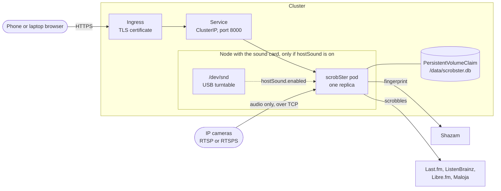

# Kubernetes with Helm

This guide installs scrobSter on a Kubernetes cluster with its Helm chart, step
by step. The short version is in [Install](../install.md#kubernetes-helm). Every
value used here is in
[`charts/scrobster/values.yaml`](../../charts/scrobster/values.yaml).

The typical cluster has no sound card, and needs none: rooms read cameras over
the network. A sound card on one node also works, at a cost in isolation.



## 1. Before you start

You need:

- A cluster on `linux/amd64`, `linux/arm64` or `linux/arm/v7`. A Raspberry Pi
  running k3s works.
- `kubectl` for that cluster, and Helm 3.8 or later, which pulls charts from OCI
  registries.
- A StorageClass that gives a `ReadWriteOnce` volume. k3s and kind have one by
  default.
- For phones: an Ingress controller and a way to get a TLS certificate, for
  example [cert-manager](https://cert-manager.io/). See [step 7](#7-https-for-phones).
- Optional: [cosign](https://github.com/sigstore/cosign), to check the chart's
  signature. See [step 3](#3-verify-the-chart).

## 2. Pick a version

The chart and the image share one version number. Pin it, so an install does
not change under you. The releases are listed on
[GitHub](https://github.com/benkelly/scrobSter/releases) and
[Artifact Hub](https://artifacthub.io/packages/search?repo=scrobster).

```sh
VERSION=0.7.1
helm show values oci://ghcr.io/benkelly/charts/scrobster --version "$VERSION"
```

The examples below use this `VERSION`.

## 3. Verify the chart

CI signs the chart and the image with keyless cosign. Check the chart before
you install it:

```sh
cosign verify ghcr.io/benkelly/charts/scrobster:"$VERSION" \
  --certificate-identity-regexp '^https://github\.com/benkelly/scrobSter/\.github/workflows/ci\.yml@refs/heads/main$' \
  --certificate-oidc-issuer https://token.actions.githubusercontent.com
```

The output names the signed digest, as `docker-manifest-digest`. A tag can
move, so to install exactly that chart, pull it and compare the `Digest:` line
that Helm prints:

```sh
helm pull oci://ghcr.io/benkelly/charts/scrobster --version "$VERSION"
# Pulled: ghcr.io/benkelly/charts/scrobster:0.7.1
# Digest: sha256:...
```

Then give Helm the file, `scrobster-$VERSION.tgz`, in place of the registry
address in steps 5 and 9.

Check the image the same way, at `ghcr.io/benkelly/scrobster:$VERSION`. See
[Releasing](../releasing.md#verifying).

## 4. Keep the secrets in a Secret

Settings that hold a secret go in a Secret. Each key becomes an environment
variable. Every variable in
[Configuration](../configuration.md#configuration-environment-variables)
works.

The chart can make the Secret from `secretEnv`, but then the values sit in your
values file and in Helm's release history. A Secret you make yourself keeps
them out of both:

```sh
kubectl create namespace music
kubectl --namespace music create secret generic scrobster-secrets \
  --from-literal=ADMIN_PASSWORD='choose-a-password' \
  --from-literal=LISTENBRAINZ_TOKEN='your-token'
```

Then name it with `existingSecret`. `secretEnv` is ignored once
`existingSecret` is set.

- `ADMIN_PASSWORD` sets the first account's password. Without it, the first
  start writes a random password to the log once.
- Service tokens, such as `LISTENBRAINZ_TOKEN`, `LASTFM_SESSION_KEY` or
  `MALOJA_KEY`, only seed the first account. After that, each user connects
  their own under Settings. See [Accounts](../configuration.md#accounts).
- `LASTFM_API_KEY` and `LASTFM_API_SECRET` identify the app to Last.fm, for
  every user. See [Connect Last.fm](../configuration.md#connect-lastfm).
- `API_TOKEN` is optional, and acts as the owner. Leave it out unless a script
  needs it. Each user also has a personal token.

The chart does not restart the pod when a Secret of your own changes, because
it never reads that Secret. Run
`kubectl --namespace music rollout restart deploy/scrobster` after you edit it.
With a values file kept in version control, changing any pod annotation does
the same on the next `helm upgrade`, for example:

```yaml
podAnnotations:
  # Bump after editing scrobster-secrets.
  secret-version: "2"
```

A change to `secretEnv` restarts the pod by itself.

## 5. Install, with cameras only

This is the usual case. The pod needs no sound card and no privileges. Write
`values.yaml`:

```yaml
existingSecret: scrobster-secrets

env:
  # Every variable in docs/configuration.md works here, as a string.
  RECOGNITION_GAP_SECONDS: "4"

persistence:
  enabled: true
  size: 1Gi
  # Leave empty for the cluster's default StorageClass.
  storageClass: ""

resources:
  requests:
    cpu: 50m
    memory: 128Mi
  limits:
    memory: 512Mi
```

Install it:

```sh
helm install scrobster oci://ghcr.io/benkelly/charts/scrobster \
  --version "$VERSION" --namespace music -f values.yaml --wait
```

`--set` works too, for a quick try, for example
`--set existingSecret=scrobster-secrets`. A values file is easier to keep.
The chart checks values against
[`values.schema.json`](../../charts/scrobster/values.schema.json), so a
misspelt key stops the install instead of being ignored.

Open the page through a port-forward until [step 7](#7-https-for-phones) is
done:

```sh
kubectl --namespace music port-forward svc/scrobster 8000:8000
```

Then open http://localhost:8000 and sign in as `admin`.

With `hostSound` off, a new database starts with no rooms. The chart sets
`CREATE_SERVER_MIC_ROOM=0`, so there is no **Server mic** room failing for want
of a sound card. On the **Rooms** tab, add each camera with its RTSP or RTSPS
address, and use **Test level**. See [Rooms and cameras](../rooms.md) for
camera tips.

`createServerMicRoom: true` or `false` overrides that choice. It only acts when
the database is made: an install from before this setting keeps its **Server
mic** room, so turn that off or delete it on the **Rooms** tab.

The pod must reach the cameras. A pod network usually reaches the home
network through the node. A NetworkPolicy that limits egress has to allow the
camera ports, often 554, 8554 for go2rtc or Frigate, or 7441 for UniFi
Protect. It must also allow HTTPS out, to Shazam and the scrobbling services.

## 6. Persistence, and why there is one pod

One SQLite file, `/data/scrobster.db`, holds accounts, rooms, credentials and
history. It lives on a PersistentVolumeClaim named `scrobster-data`.

- **The chart always runs one replica.** There is no replica count to change.
  SQLite is one file for one process, and Shazam's rate limit is shared by all
  rooms through one queue in that process. Two pods would each listen, ask
  Shazam twice as often, and scrobble every song twice.
- **Upgrades stop the old pod first** (the `Recreate` strategy), so two never
  run at once. Expect a short gap.
- **Uninstalling keeps the claim.** Delete it by hand to start again:
  `kubectl --namespace music delete pvc scrobster-data`.
- **Use a claim you made**, for example on a volume you back up, with
  `persistence.existingClaim`. `ReadWriteOnce` is enough.
- **Treat the volume as a secret.** It holds every user's service credentials.
  See [SECURITY.md](../../SECURITY.md#what-is-sensitive).
- `persistence.enabled: false` uses an `emptyDir`. Accounts and history are lost
  when the pod goes. Use it only for a test.

The pod runs as uid 1000, and `fsGroup: 1000` makes a fresh volume writable for
it. CI checks both in a kind cluster.

## 7. HTTPS, for phones

A browser only gives a page the microphone in a secure context:
`http://localhost`, or HTTPS. A phone on your network needs HTTPS. See
[Two ways to listen](../rooms.md#two-ways-to-listen).

Add this to `values.yaml`. It assumes ingress-nginx and a cert-manager
ClusterIssuer named `letsencrypt`. Change both to what your cluster has.

```yaml
ingress:
  enabled: true
  className: nginx
  annotations:
    cert-manager.io/cluster-issuer: letsencrypt
  hosts:
    - host: scrobster.example.com
      paths:
        - path: /
          pathType: Prefix
  tls:
    - secretName: scrobster-tls
      hosts:
        - scrobster.example.com
```

Apply it with `helm upgrade` as in [step 9](#9-upgrade). Then open
`https://scrobster.example.com` on the phone and select *use this device's
mic*.

- **The sign-in cookie is marked Secure** when the request arrives as HTTPS,
  which the app reads from `X-Forwarded-Proto`. ingress-nginx and Traefik send
  it by default.
- **A name only on your network still works.** cert-manager's DNS-01 challenge
  issues a certificate without opening a port to the internet. A Tailscale
  operator or a private CA also works, as long as the phone trusts the
  certificate.
- **The chart sets `TRUST_INGRESS=0`.** Setting it in `env` or `secretEnv`
  stops the install with an error. A pod can hold the address Home Assistant's
  ingress uses, and the app would sign that pod in as the owner. See
  [SECURITY.md](../../SECURITY.md).

Without an Ingress, `service.type: LoadBalancer` or `NodePort` also publishes
the page, but over plain HTTP, so phones cannot use their microphone.

## 8. A sound card on one node

Use this when a USB turntable or a microphone is plugged into one node, for
example a Raspberry Pi next to the hi-fi. See
[Rooms and cameras](../rooms.md) for which input to use.

On that node, find the card and the group ID that owns `/dev/snd`:

```sh
arecord -l
# card 1: CODEC [USB Audio CODEC], device 0: USB Audio [USB Audio]
stat -c %g /dev/snd/controlC0
# 29
```

That is the `audio` group on the node, 29 on Debian and Raspberry Pi OS.
Other systems can use another number. It is the node's number that counts, not
a group in the image: the pod gets it as a supplemental group.

Label the node, so the pod can be pinned to it:

```sh
kubectl label node livingroom-pi scrobster/sound-card=true
```

Add this to `values.yaml`:

```yaml
hostSound:
  enabled: true
  # The group ID that owns /dev/snd on the node, from stat -c %g.
  audioGroup: 29

nodeSelector:
  scrobster/sound-card: "true"

env:
  # Card names survive a reboot. Card numbers can change.
  AUDIO_DEVICE: "hw:CARD=CODEC,DEV=0"
```

Then apply it with `helm upgrade` as in [step 9](#9-upgrade). On the
**Rooms** tab, edit **Server mic**, or add a microphone room, pick the card,
and use **Test level** while a record plays. A new install with `hostSound` on
starts with **Server mic**. One that began with cameras only has no such room,
so add a microphone room. Near -20 dB is typical for a
turntable. Near -91 dB means the wrong card.

What `hostSound.enabled` changes:

- It mounts the node's `/dev/snd` into the container.
- It adds `audioGroup` to the pod's groups, so the scrobster user may open the
  card. The process still runs as uid 1000.
- It makes a new database start with the **Server mic** room.
- It makes the container **privileged**, which replaces `securityContext`.
  Kubernetes has no way to hand one host device to a container without that,
  short of a device plugin.

The trade-offs:

- **A privileged container is close to root on the node.** It sees every host
  device, not only the sound card, and runs with no seccomp or AppArmor
  profile. A flaw in the app, or in ffmpeg reading a hostile stream, would be
  much worse than in the default pod. Keep it on a node that runs nothing
  else that matters, in its own namespace.
- **Pod Security Admission rejects it** under the `baseline` and `restricted`
  levels. The namespace needs the `privileged` level:
  `kubectl label namespace music pod-security.kubernetes.io/enforce=privileged`.
- **The pod can only run on that node.** If the node is down, scrobSter is
  down, cameras included. Cameras alone can run anywhere, so consider a
  Raspberry Pi outside the cluster, running the
  [Docker image](../install.md#docker-linux-host) with `--device /dev/snd`, if
  that matters to you.
- **The volume must be reachable from that node.** A node-local StorageClass,
  such as k3s's `local-path`, binds the volume to the node the pod first ran
  on. Pin the pod before the first install, or the claim and the node
  disagree and the pod stays Pending.

A device plugin that offers `/dev/snd` as a resource, such as
[smarter-device-manager](https://github.com/smarter-project/smarter-device-manager),
can avoid the privileged container. Leave `hostSound` off, ask for the
resource under `resources.limits`, and add the group with
`podSecurityContext.supplementalGroups`. This route is not tested here.

## 9. Upgrade

Back up the database first. Upgrades move it forward, and an older version
may not read it again. `helm rollback` restores the chart, not the data.

```sh
kubectl --namespace music exec deploy/scrobster -- python -c \
  "import sqlite3; sqlite3.connect('/data/scrobster.db').backup(sqlite3.connect('/data/backup.db'))"
kubectl --namespace music cp \
  "$(kubectl --namespace music get pod -l app.kubernetes.io/instance=scrobster -o name | cut -d/ -f2)":/data/backup.db \
  ./scrobster-backup.db
```

Then upgrade with the same values file and the new version:

```sh
VERSION=0.6.3
helm upgrade scrobster oci://ghcr.io/benkelly/charts/scrobster \
  --version "$VERSION" --namespace music -f values.yaml --wait
```

Read the [release notes](https://github.com/benkelly/scrobSter/releases)
first. Only the latest release gets security fixes, so keep up. See
[SECURITY.md](../../SECURITY.md#supported-versions).

## When something is wrong

```sh
kubectl --namespace music get pod,pvc
kubectl --namespace music describe pod -l app.kubernetes.io/instance=scrobster
kubectl --namespace music logs deploy/scrobster
```

- **Pending:** the claim found no volume, or `nodeSelector` matches no node, or
  the volume is bound to another node.
- **Forbidden by PodSecurity:** `hostSound` is on in a namespace below the
  `privileged` level.
- **"unable to open database file":** the volume is not writable for uid 1000.
  Keep `podSecurityContext.fsGroup` at 1000.
- **No password set:** find the one the first start logged with
  `kubectl --namespace music logs deploy/scrobster | grep "first account"`.
- **A camera room fails:** see [Troubleshooting](../troubleshooting.md) and
  [Rooms and cameras](../rooms.md).
