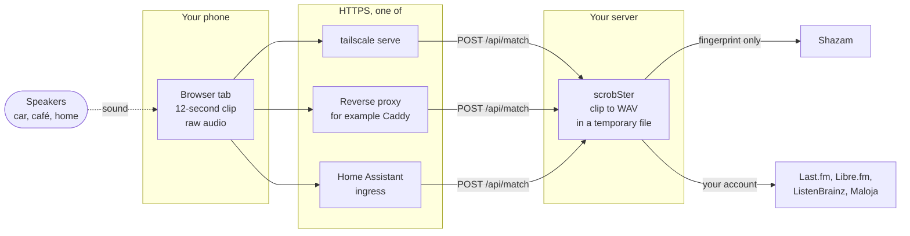

# A phone as the microphone

The web page can listen through the microphone of the phone or laptop you open
it on. Select **Use this device's mic** on the Listening tab. The page records
12-second clips and posts them to `POST /api/match`. The server identifies each
clip and scrobbles it for the account you signed in with, through the same
duplicate filter as the rooms. See [Two ways to listen](../rooms.md#two-ways-to-listen)
for how this compares with a server microphone.


This guide covers, in order:

1. [Put the page behind HTTPS](#step-1-put-the-page-behind-https)
2. [Open the page and sign in](#step-2-open-the-page-and-sign-in)
3. [Allow the microphone](#step-3-allow-the-microphone)
4. [Keep the screen on](#step-4-keep-the-screen-on)
5. [Get good matches](#step-5-get-good-matches)

Then: [the car, a café, at home](#where-to-use-it), [privacy, data and
battery](#privacy-data-and-battery), and [when something goes
wrong](#when-something-goes-wrong).

This is the whole path of one clip:



## Step 1. Put the page behind HTTPS

Browsers give a page the microphone only in a secure context: an `https://`
address, or `http://localhost`. A plain `http://` address on your network,
such as `http://192.168.1.20:8000`, is not one. On such an address the page
says *This browser only allows microphone access over https, or on
localhost*.

`http://localhost` works only in a browser on the server itself. A phone
cannot use it.

Pick one of these three ways.

### Tailscale

This is the simplest if you already use [Tailscale](https://tailscale.com).
The page stays private to your tailnet, and Tailscale gets the certificate.

1. In the Tailscale admin console, under DNS, turn on MagicDNS and HTTPS
   certificates.
2. On the server, serve port 8000 over HTTPS:

   ```sh
   tailscale serve --bg 8000
   ```

   It prints the address, for example `https://pi.your-tailnet.ts.net`.
3. Install Tailscale on the phone, sign in to the same tailnet, and keep it
   connected.
4. Open that address on the phone.

The phone needs Tailscale on whenever you listen, over Wi-Fi or mobile data.

### A reverse proxy with a real certificate

Use this if you have a domain name. [Caddy](https://caddyserver.com) gets
and renews the certificate by itself. A minimal `Caddyfile`:

```caddy
scrobster.example.com {
    reverse_proxy localhost:8000
}
```

The name must point at the proxy, and the proxy must reach port 8000. Caddy
sends `X-Forwarded-Proto: https`, so scrobSter marks its sign-in cookie
secure. Any proxy that sends that header works the same way. A proxy open to
the internet shows the sign-in page to the internet, so give every account a
strong password.

### Home Assistant ingress

With the [Home Assistant add-on](../home-assistant.md), the page opens
through Home Assistant, as a panel. The microphone then works only if you
reach Home Assistant itself over HTTPS: through Home Assistant Cloud (Nabu
Casa), or your own certificate. `http://homeassistant.local:8123` is not a
secure context.

Two things to know:

- Ingress signs you in as the owner. Clips sent this way scrobble for the
  owner's account, whoever holds the phone.
- This path has not been tested end to end on a phone. If the button does
  nothing or the microphone is blocked inside the Home Assistant app, use
  Tailscale or a proxy instead.

## Step 2. Open the page and sign in

Open the HTTPS address and sign in. The session lasts 30 days, so you sign in
again about once a month on each browser.

The page sets a home screen icon, so you can add it to the home screen:

- **iPhone, Safari:** the Share button, then **Add to Home Screen**.
- **Android, Chrome:** the menu, then **Add to Home screen**.

This is a shortcut to the page. scrobSter has no web app manifest, so it is
not installed as an app. On an iPhone, if the shortcut opens on its own,
without Safari's address bar, it keeps its own sign-in: sign in once more
there.

## Step 3. Allow the microphone

Select **Use this device's mic**. The browser asks for the microphone. Allow
it.

Once it is allowed, a menu next to the button lists the microphones, when
there is more than one. Pick the phone's own microphone. The page remembers
the choice in this browser. A live meter under the buttons shows what the
microphone hears.

**iPhone, Safari.** Safari may ask again on later visits. To stop the
question:

- On the page, select **aA** in the address bar, then **Website Settings**,
  and set **Microphone** to **Allow**.
- For every site: Settings > Apps > Safari > Microphone.

If you selected **Don't Allow**, the page says *Microphone blocked*. Change it
in the same places, then reload the page.

**Android, Chrome.** Select the icon left of the address, then
**Permissions**, and turn on **Microphone**. If it was blocked, use
**Reset permissions** there, and reload the page. Chrome also needs the
microphone permission for itself: Settings > Apps > Chrome > Permissions.

## Step 4. Keep the screen on

The page records only while its tab is open, in front, and the screen is on.
A phone stops recording when the screen sleeps. The page does not keep the
screen awake by itself: it does not use the Screen Wake Lock API. So change
the phone's setting while you listen:

- **iPhone:** Settings > Display & Brightness > Auto-Lock > **Never**. Low
  Power Mode limits Auto-Lock to 30 seconds, so turn it off while you listen.
- **Android:** Settings > Display > **Screen timeout**, set to the longest.
  The name differs between makers.

Switching to another app, a call or Siri can take the microphone away. If the
meter stops moving when you come back, select **Stop this device's mic**, then
**Use this device's mic** again.

## Step 5. Get good matches

- **Watch the meter.** Aim for a level near -20 dBFS while music plays. Near
  -91 dBFS means the microphone hears nothing.
- **Get closer, or turn it up.** Level matters most. Shazam tolerates a lot of
  noise, but it fails once the music sits well below the chatter. See
  [Recognition limits](../troubleshooting.md#recognition-limits-measured).
- **Point the bottom of the phone at a speaker.** That is where the main
  microphone is on most phones. Do not cover it.
- **Raw audio is asked for already.** The page turns off echo cancellation,
  noise suppression and automatic gain control, because they remove what
  Shazam needs. Nothing to set.
- **Mic Mode on an iPhone.** If Control Center shows **Mic Mode** while the
  page listens, choose **Standard**. Voice Isolation removes everything except
  speech, and it destroys the fingerprint. Some Android phones have a similar
  voice focus setting: turn it off.
- **Avoid a Bluetooth microphone.** A headset or a car's hands-free microphone
  records at call quality, which matches poorly. Pick the phone's own
  microphone in the menu.

Each cycle takes 15 to 20 seconds: a 12-second clip, the answer, then a short
pause. So a song is usually matched within the first half minute.

## Where to use it

### In the car

First ask where the music comes from.

- **The phone plays it**, over Bluetooth or a cable, from Spotify or another
  app. The microphone would only hear the phone's own playback through the car
  speakers. Use the service's own scrobbling instead: for example, connect
  Spotify to Last.fm or ListenBrainz on their sites. It is exact, and costs no
  battery. Do not run both, or each play is scrobbled twice.
- **The car plays it**: radio, a CD, a USB stick. Then the microphone is the
  way. Put the phone in a holder, on a charger, with the screen on, and with
  its microphone free.

A phone connected to the car over Bluetooth may switch to the car's
hands-free microphone, or to call-quality audio, when the page opens the
microphone. If the music turns muffled, or the menu shows the car, pick the
iPhone or phone microphone in the menu.

Road noise is loud. Keep the music louder than the road, and expect fewer
matches on a motorway.

### In a café

Sit near a speaker. Talk at your table is the main problem: a clip that is
mostly speech does not match. Matches come between conversations, or when the
music is loud enough. The meter tells you whether the phone hears the music
at all.

### At home

A phone works for a room without a server microphone. For a room you use
every day, a [room](../rooms.md) on the server is better: it needs no open
tab, no awake screen and no phone.

## Privacy, data and battery

**Clips go to your server only.** The phone sends each clip to scrobSter over
HTTPS. The server decodes it into a temporary file, computes the fingerprint
locally, and sends only the fingerprint to Shazam. The audio is not kept.
Matches scrobble to the services of the account that sent the clip.

**Mobile data.** The browser compresses each clip with its own codec: Opus in
Chrome, AAC in Safari. Expect roughly 50 to 200 kB per clip, so about 10 to
40 MB per hour of listening. This is an estimate from the codecs' usual
bitrates, not a measurement. Over Tailscale the traffic is the same.

**Battery.** The screen stays on, the microphone records, and a clip is sent
every 15 seconds or so. Plan for a charger on a long drive. Stop the
microphone when you are done.

## Rate limits

Shazam's limit is shared. Clips from phones and every room on the server ask
Shazam from the same address, and wait their turn: at most one request every
`RECOGNITION_GAP_SECONDS`, 4 by default. A phone adds about one request every
15 seconds, so many phones and rooms at once slow every answer.

Unlike a room, the phone does not skip silent clips, and does not skip a song
it already knows. Every clip asks Shazam. Stop the microphone when no music
plays.

When Shazam limits requests, every room and every phone pauses, from one
minute up to ten. The page then shows *Error: HTTP 429* and keeps trying. See
[Rooms and cameras](../rooms.md) for the shared limit, and the
**Recognition** card on the Rooms tab for the request count.

## When something goes wrong

The note under the meter says what happened:

| The page says | What to do |
|---|---|
| *This browser only allows microphone access over https, or on localhost* | The address is plain `http://`. See [step 1](#step-1-put-the-page-behind-https). |
| *Microphone blocked* | The permission was refused. See [step 3](#step-3-allow-the-microphone). |
| *No match (input -91 dBFS)* | The microphone hears nothing. Pick another one in the menu, or check that nothing covers it. |
| *No match* at a good level | Too much speech or noise, or the recording is not in Shazam. See [Troubleshooting](../troubleshooting.md). |
| *Error: HTTP 401* | The session ended. Reload the page and sign in. |
| *Error: HTTP 415* | The server could not decode the clip. Check that ffmpeg works on the server. |
| *Error: HTTP 429* | Shazam is limiting requests. See [Rate limits](#rate-limits). |
| *Error: HTTP 502* | Shazam could not be reached. The page tries again with the next clip. |
| The meter stops moving | The phone took the microphone away. Stop and start the microphone again. |

For every route the page uses, see the [API](../api.md).
