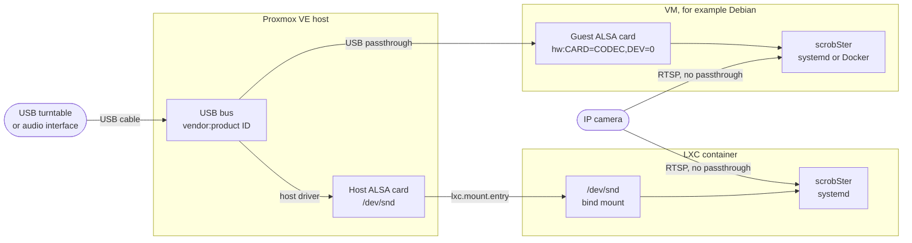

# Proxmox VE

This guide runs scrobSter on a Proxmox VE host, in a virtual machine or in an
LXC container. It was written for Proxmox VE 8.x. The commands and
configuration keys are taken from the Proxmox documentation, but this guide has
**not been tested on real Proxmox hardware**. If a step differs on your
version, please open an issue.

The hard part is the sound card. A USB turntable or a USB audio interface is
plugged into the Proxmox host, and scrobSter runs in a guest. The device has to
reach the guest first. Cameras need none of this.

## Choose a way

| You have | Use | Why |
|---|---|---|
| Cameras or streams only | An LXC container with the [systemd install](../install.md#run-as-a-service-systemd), or Docker in a VM you already run | Cameras arrive over the network. No device is passed through. |
| A USB turntable or audio interface, and you want it simple | A VM with USB passthrough | The VM owns the device, like a real computer. No ID mapping. |
| A USB device, and you want it light | An LXC container with `/dev/snd` bind-mounted | Less memory and disk. Group permissions need care. |

This is how the sound reaches scrobSter in each case:



Use one of the two paths for a USB device, not both. While a VM runs with the
device passed through, the host no longer sees it, so `/dev/snd` on the host
does not have it either.

## Cameras only

Nothing is passed through. Make a small container and install scrobSter in it:

1. In the web UI, **Create CT**. Pick a Debian template, keep **Unprivileged
   container** checked, and give it 1 core, 512 MB of memory and 4 GB of disk.
   That is a starting point, not a measured minimum.
2. Start it and open its console. Install what scrobSter needs:

   ```sh
   apt update
   apt install -y git python3-venv ffmpeg
   ```

3. Follow [Run as a service (systemd)](../install.md#run-as-a-service-systemd).
4. Open `http://<container-ip>:8000`, and add each camera on the **Rooms** tab.
   See [Rooms and cameras](../rooms.md) for camera tips.

If you already run Docker in a VM, the [Docker install](../install.md#docker-linux-host)
works there too. Leave out `--device /dev/snd` and `--group-add audio`.

## Find the device on the host

Plug the turntable or interface into the Proxmox host and switch it on. In the
host's shell:

```sh
lsusb
# Bus 001 Device 004: ID 08bb:2902 Texas Instruments PCM2902 Audio Codec
```

`08bb:2902` is the vendor and product ID. Yours may differ. Many USB
turntables use this codec, and appear in ALSA as `USB Audio CODEC`.

For the LXC path, also check that the host made a sound card:

```sh
cat /proc/asound/cards
ls -l /dev/snd
```

## VM with USB passthrough

The VM gets the USB device as if it were plugged into it. Its own kernel loads
the USB audio driver.

### 1. Make the VM

Install Debian, or another Linux, in a VM as usual. 1 core, 1 GB of memory and
8 GB of disk is a reasonable start for scrobSter alone. That is a guess, not a
measurement.

### 2. Pass the device through

In the web UI: select the VM, then **Hardware > Add > USB Device**. Choose
**Use USB Vendor/Device ID**, pick the device from the list, and **Add**.

Or in the host's shell, with your VM's ID and the ID from `lsusb`:

```sh
qm set <vmid> -usb0 host=08bb:2902
```

Stop and start the VM if the device does not show up in it. A reboot from
inside the guest is not always enough for a hardware change. A full stop and
start is.

Notes:

- **The device belongs to the VM.** While the VM runs, the host and every other
  guest lose it.
- **Pass by ID, not by port, unless you have two of the same device.** An ID
  follows the device to any port. Two identical interfaces share one ID, so
  pass each by **Use USB Port** instead, and keep each in its port.
- **USB 2 or 3.** USB audio is USB 2 or slower. On Proxmox VE 7.1 and later,
  with a current machine type and a Linux OS type, passed-through devices go on
  a USB 3 (xHCI) controller anyway, and the `usb3=1` flag
  (`-usb0 host=08bb:2902,usb3=1`) makes no difference. On an older machine type
  it selects the USB 3 controller. Try the default first.
- **USB audio in a VM can drop samples** under heavy host load, because the
  host forwards each USB transfer. A 12-second clip for Shazam tolerates a
  small glitch. If **Test level** or matches look poor, try a different host
  port, or a USB 2 port, before anything else. Passing a whole USB controller
  as a PCI device avoids this, but needs IOMMU and is beyond this guide.

### 3. Check the device in the VM

```sh
sudo apt install -y alsa-utils usbutils
lsusb
arecord -l
# card 1: CODEC [USB Audio CODEC], device 0: USB Audio [USB Audio]
```

The VM has no other sound card unless you added one, so the USB device is
often card 0 or card 1.

### 4. Install scrobSter in the VM

Either way from [Install](../install.md) works, exactly as on a physical
machine:

- [Docker](../install.md#docker-linux-host), with `--device /dev/snd --group-add audio`,
  or the [compose file](../../docker-compose.yml).
- [systemd](../install.md#run-as-a-service-systemd). First
  `sudo apt install -y git python3-venv ffmpeg`.

Then [pin the card and test it](#pin-the-card-and-test-it).

## LXC container with /dev/snd

The host's own USB audio driver makes the sound card. The container shares the
host kernel, so it can use the card's device files, `/dev/snd/*`, once they are
mounted in and it is allowed to open them.

ALSA's device files use major number 116. The host keeps the device: other
containers can mount it too, and two programs recording the same card at once
may fail with "device busy".

### 1. Make the container

**Create CT** in the web UI, from a Debian template. Note its ID, for example
`105`. Choose privileged or unprivileged now, using
[step 3](#3-let-the-container-open-the-device) below. You cannot simply switch
an existing container between the two.

Stop the container before you edit its configuration.

### 2. Mount /dev/snd

On the host, add these two lines to `/etc/pve/lxc/<id>.conf`:

```ini
lxc.cgroup2.devices.allow: c 116:* rwm
lxc.mount.entry: /dev/snd dev/snd none bind,optional,create=dir
```

The first line lets the container open ALSA devices. The second mounts the
host's `/dev/snd` at the same place. `optional` lets the container start when
`/dev/snd` is missing on the host. `create=dir` makes the mount point.

### 3. Let the container open the device

On the host, the files in `/dev/snd` belong to the `audio` group, GID 29 on
Debian and so on Proxmox VE, with mode `0660`. Whether the container can open
them depends on its type.

**Privileged container.** User and group IDs are the same inside and out. A
Debian or Ubuntu container also uses GID 29 for `audio`, so the `scrobster`
user in the `audio` group can read the card. This is the simplest choice. The
cost is isolation: root in a privileged container is close to root on the
host. Proxmox recommends unprivileged containers for that reason.

**Unprivileged container.** IDs inside are shifted by 100000 on the host. The
host's GID 29 is not mapped into the container, so the files appear as owned by
`nobody:nogroup`, and the container's `audio` group (host GID 100029) cannot
open them. Every room then reports a capture error. There are three ways out.
Choose one.

- **Map the audio group through (recommended).** The container's GID 29 then
  is the host's GID 29. Add these lines to `/etc/pve/lxc/<id>.conf`. They
  replace the default mapping, so all four `g` and `u` lines are needed:

  ```ini
  lxc.idmap: u 0 100000 65536
  lxc.idmap: g 0 100000 29
  lxc.idmap: g 29 29 1
  lxc.idmap: g 30 100030 65506
  ```

  And allow root to map that one group, by adding this line to `/etc/subgid`
  on the host:

  ```text
  root:29:1
  ```

  The trade-off is small: the container's `audio` group is the host's `audio`
  group. Any file in the container that was already owned by group `audio`
  appears as `nogroup` afterwards. A fresh container has none that matter.

- **Change the group on the host.** Give the device files the container's
  mapped GID, 100029. Done by hand, this is lost at every reboot and every
  replug:

  ```sh
  chgrp 100029 /dev/snd/*
  ```

  A udev rule on the host makes it stick. Save it as
  `/etc/udev/rules.d/99-lxc-snd.rules`, then run
  `udevadm control --reload && udevadm trigger --subsystem-match=sound`:

  ```text
  SUBSYSTEM=="sound", GROUP="100029", MODE="0660"
  ```

  The host's own `audio` group then loses the card, which a Proxmox host
  normally never uses. This rule has not been tested here. If udev does not
  accept a numeric group on your version, use the idmap above.

- **Open the card to everyone.** `MODE="0666"` in the same rule lets any user,
  in any container that mounts `/dev/snd` and on the host, record from it. It
  is the bluntest fix, and only reasonable on a host you alone use.

Recent Proxmox VE 8 releases also offer **Resources > Add > Device
Passthrough** for containers, which passes single device files with a chosen
group. ALSA needs several files per card, such as `controlC1` and `pcmC1D0c`,
and their names follow the card number, so the bind mount above is easier to
keep working. This guide does not cover that option.

### 4. Start and check

Start the container and open its console:

```sh
apt update
apt install -y alsa-utils
ls -l /dev/snd
arecord -l
# card 1: CODEC [USB Audio CODEC], device 0: USB Audio [USB Audio]
```

`ls -l` should show the files in group `audio`, not `nogroup`. The card number
is the host's, because the container shares the host's kernel.

### 5. Install scrobSter

**The systemd install is the simpler choice in a container.** Install the
packages, then follow
[Run as a service (systemd)](../install.md#run-as-a-service-systemd):

```sh
apt install -y git python3-venv ffmpeg
```

Its `useradd --groups audio` and `SupplementaryGroups=audio` are what let the
service read the card.

**Docker inside the container** works too, but adds a layer. Turn on nesting,
and for an unprivileged container keyctl, on the host:

```sh
pct set <id> --features nesting=1,keyctl=1
```

Then install Docker in the container and use the
[Docker install](../install.md#docker-linux-host). `--group-add audio` gives the
container GID 29, so the permission fix in step 3 still applies. Proxmox's own
documentation suggests a VM rather than a container for Docker. Running Docker
this way has not been tested with scrobSter.

## Pin the card and test it

Open `http://<guest-ip>:8000` and sign in as an administrator. On the **Rooms**
tab, add a microphone room and pick the device from the list. Use **Test
level** while a record plays. Near -20 dB is typical for a turntable. Near
-91 dB means the wrong card, or the turntable is set to its Bluetooth output.

Pin the device by its card name, not its number:

```text
hw:CARD=CODEC,DEV=0
```

The name comes from `arecord -l`: the word after `card 1:`. Card numbers can
change at boot, or when a card is plugged in again. In an LXC container this
matters more, because the numbers are the host's, and every USB audio device on
the host counts. See [Find your audio device](../rooms.md#find-your-audio-device)
for the details, and [Troubleshooting](../troubleshooting.md) when nothing
matches.

## When the turntable is switched off

Many USB turntables disappear from USB when switched off, and appear again when
switched on. What scrobSter does is the same everywhere: a room that cannot
record logs one warning, then retries quietly, up to once a minute, and logs
one line when it works again. Each try opens the device afresh, so a card that
comes back under the same name is found again. This is described for cameras
in [Rooms and cameras](../rooms.md), and microphone rooms do the same.

What the guest sees differs:

- **VM, passed by ID.** QEMU watches for a device with that vendor and product
  ID, and attaches it to the VM again when it reappears. This is how USB
  passthrough by ID is meant to work. It has not been tested here with a
  turntable. If the device does not come back, remove and add it under
  **Hardware**, or stop and start the VM.
- **VM, passed by port.** The device comes back if it is plugged into the same
  port.
- **LXC container.** The bind mount is of the `/dev/snd` directory, so new
  device files that the host makes appear in the container too. The directory
  itself stays, because it also holds `seq` and `timer`. The new files get
  their group from the host's udev: with the idmap or the udev rule above this
  is right again, but a `chgrp` by hand is lost. This follows from how bind
  mounts work and has not been tested on Proxmox.

In every case, `hw:CARD=...` keeps working when the card comes back with a
different number. A bare `hw:1,0` may not.
