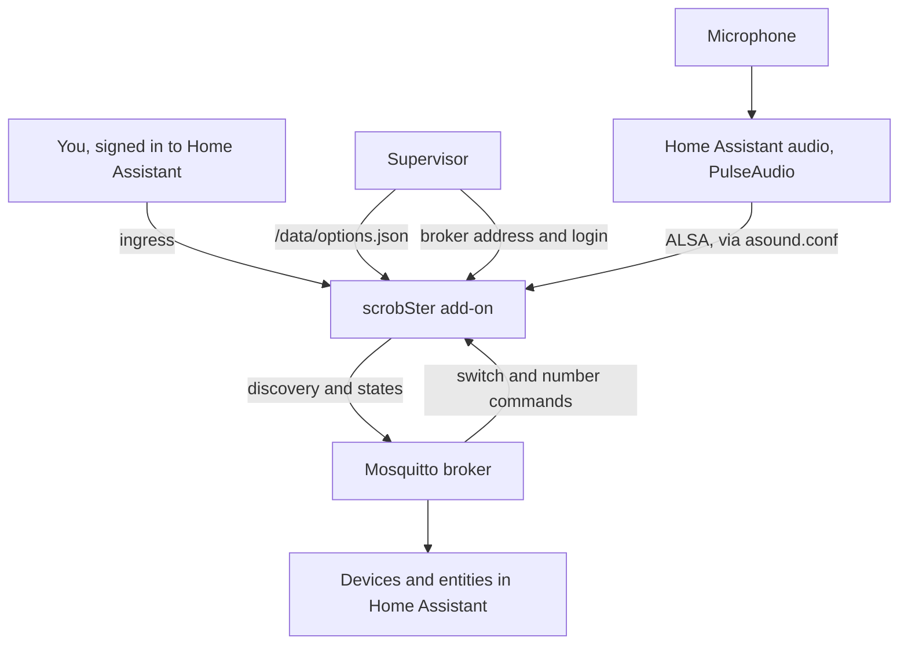

# Home Assistant

scrobSter is available as a Home Assistant add-on from
https://github.com/benkelly/ha-addons. The add-on runs this same image and takes
the microphone from the Home Assistant audio system, so you choose the input in
the add-on configuration. To set it up step by step, follow the
[getting-started guide](guides/home-assistant.md).

The app also reads `/data/options.json` directly, which is where the Supervisor
writes add-on options. Each key matches an environment variable, in either case.
No wrapper script is needed.

This is how the add-on connects to Home Assistant:



Ingress signs you in as the owner, so the page asks for no password.

## Devices over MQTT

scrobSter publishes its rooms and users to Home Assistant through MQTT
discovery, so they appear as devices with no YAML. The add-on finds the
Mosquitto broker by itself. Anywhere else, set `MQTT_HOST`, and the credentials
if the broker needs them.

| Device | Entities |
|---|---|
| **scrobSter** | Listening switch, Shazam rate limit, Shazam requests in the last ten minutes, and the two recognition rates as numbers |
| **One per room**, in the Home Assistant area of the same name | Now playing (`Artist - Title`, or `idle`), with the track as attributes; Cover art; Music; Input level in dBFS; Recording; Problem, on while the room keeps failing, with `failing_since` and the reason; Last error; a Listen here switch; and a Match event |
| **One per user** | Last scrobble, with the track as attributes; Scrobbles today; Services; and a Scrobble switch for every room |

Everything is pushed when it changes, so Home Assistant polls nothing. Rooms and
users appear and disappear as they are added and removed, also when that
happened while scrobSter was not connected. When scrobSter stops, its entities
show as unavailable.

The Match event fires when a room starts hearing a song: a new track, or the
same one after `NOW_PLAYING_STOP_SECONDS` of quiet. It carries the artist,
title, album, cover, and the users who received it, so an automation can react
to a song:

```yaml
automation:
  - alias: Dim the kitchen for Daft Punk
    triggers:
      - trigger: state
        entity_id: event.scrobster_kitchen_match
    conditions:
      - condition: template
        value_template: "{{ trigger.to_state.attributes.artist == 'Daft Punk' }}"
    actions:
      - action: light.turn_on
        target: {entity_id: light.kitchen}
        data: {brightness_pct: 30}
```

**The broker is the gate for commands.** Its switches and numbers act like an
administrator: whoever can publish to the broker can start and stop listening,
change the rates, and choose rooms for any user. Keep the broker private, as
the Mosquitto add-on is. Camera URLs and service credentials are never
published.

Each install has its own instance id, kept in the database, so two installs can
share one broker. Inside scrobSter, every change goes through one event stream
(`scrobster/events.py`). MQTT is one reader of it, and `GET /api/events` serves
it to any other client, such as a script or a future Home Assistant
integration:

```sh
curl -N -H "Authorization: Bearer your-token" http://your-host:8000/api/events
```

Without MQTT, a REST sensor can read `/api/status`. See [API](api.md).

## Cover art for a display

Each room's **Cover art** image shows the record it is playing, and goes
unavailable when the music stops: `NOW_PLAYING_STOP_SECONDS` after the last
match, the same moment Now playing reads `idle`. So a dashboard by the hi-fi
never keeps showing the last record. This card shows the cover only while
there is one:

```yaml
type: conditional
conditions:
  - condition: state
    entity: image.scrobster_kitchen_cover_art
    state_not: unavailable
card:
  type: picture-entity
  entity: image.scrobster_kitchen_cover_art
  show_name: false
  show_state: false
```

The Now playing sensor carries the cover's address as its `art_url` attribute,
for a template or a Markdown card. Home Assistant does not take an entity
picture from MQTT attributes, so for a picture use the image entity.

### Without Home Assistant

A display that reads MQTT itself, such as an ESP32 with a screen, a Node-RED
flow or a script on a Pi, can follow a room on two retained topics under
`<MQTT_TOPIC>/<instance>/room/<room id>/`. They are sent again only when the
record changes, not on every match:

| Topic | Payload |
|---|---|
| `now_playing` | JSON: `room`, `playing`, `artist`, `title`, `album` and `art_url`. Once the music stops, `playing` is `false` and the rest is `null`, but for `room` |
| `playing` | `ON` or `OFF` |
| `cover` | the cover's URL, as plain text, for Home Assistant's image. It is never emptied, so it still holds the last cover after the music stops, or while a record without one plays. A display should take `art_url` from `now_playing` instead |

The instance is a short id kept in the database. To see it, and every room:

```sh
mosquitto_sub -h your-broker -v -t 'scrobster/+/room/+/now_playing'
```

```
scrobster/3f9a1c/room/1/now_playing {"album": "Discovery", "art_url": "https://is1-ssl.mzstatic.com/.../400x400cc.jpg", "artist": "Daft Punk", "playing": true, "room": "Kitchen", "title": "One More Time"}
scrobster/3f9a1c/room/2/now_playing {"album": null, "art_url": null, "artist": null, "playing": false, "room": "Hall", "title": null}
```

The cover URL is the one Shazam gives, on its image server, so the display
needs to reach the internet to load it.
