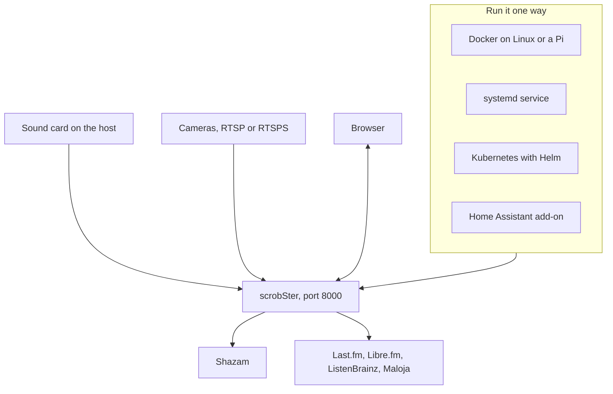

# Install

For the Home Assistant add-on, see [Home Assistant](home-assistant.md) and its
[getting-started guide](guides/home-assistant.md). On Proxmox VE, see the
[Proxmox guide](guides/proxmox.md).

Every way runs the same single process, with its SQLite database. This is what
it talks to:



## Docker (Linux host)

Images are published to GitHub Packages for `linux/amd64`, `linux/arm64` and
`linux/arm/v7`, so a Raspberry Pi works on a 64-bit or a 32-bit OS, for example
a Pi 3B on DietPi or Raspberry Pi OS. Docker pulls the right one by itself. To
run without Docker, install as in the README's [Quick start](../README.md#quick-start) and run it as a service as below.

```sh
docker run -d --name scrobster \
  --device /dev/snd --group-add audio \
  -p 8000:8000 \
  -v scrobster-data:/data \
  -e LISTENBRAINZ_TOKEN=your-token \
  ghcr.io/benkelly/scrobster:latest
```

Or use the compose file in this repository:

```sh
docker compose up -d
```

Tags: `latest` for the main branch, `1.2.3` and `1.2` for a release, and a short
commit SHA for every build.

Notes:

- The container runs as root by default, because the Home Assistant add-on
  needs that. To run it unprivileged, add `--user 1000:1000` and keep
  `--group-add audio`: reading the sound card then needs the host audio group.
- Docker Desktop on macOS cannot reach the microphone. Run bare on macOS.
- `SSL_CERT_FILE` is only for macOS. scrobSter ignores it when the file is
  missing, so the same `.env` works in a container.

## Run as a service (systemd)

For a bare install on a Linux box such as a Raspberry Pi, a systemd unit
starts scrobSter at boot and restarts it if it stops. These steps install it
in `/opt/scrobster` under its own user:

```sh
sudo useradd --system --home-dir /opt/scrobster --groups audio scrobster
sudo git clone https://github.com/benkelly/scrobSter /opt/scrobster
cd /opt/scrobster
sudo python3 -m venv .venv
sudo .venv/bin/pip install -r requirements.txt
sudo chown -R scrobster:scrobster /opt/scrobster
```

Put your settings in `/opt/scrobster/.env`, as in [Quick start](../README.md#quick-start). Then save this
as `/etc/systemd/system/scrobster.service`:

```ini
[Unit]
Description=scrobSter
Wants=network-online.target
After=network-online.target sound.target

[Service]
User=scrobster
SupplementaryGroups=audio
# .env and the database are found relative to this directory.
WorkingDirectory=/opt/scrobster
ExecStart=/opt/scrobster/.venv/bin/python -m scrobster
Restart=always
RestartSec=5

[Install]
WantedBy=multi-user.target
```

And start it:

```sh
sudo systemctl daemon-reload
sudo systemctl enable --now scrobster
journalctl -u scrobster -f
```

The first start without `ADMIN_PASSWORD` writes the random password to that log.
The `audio` group lets the service read the sound card. Without it, every room
reports a capture error.

## Kubernetes (Helm)

The [Kubernetes guide](guides/kubernetes.md) goes through it step by step.

The chart is published next to the image, with the same version:

```sh
helm install scrobster oci://ghcr.io/benkelly/charts/scrobster \
  --namespace music --create-namespace \
  --set secretEnv.ADMIN_PASSWORD=choose-a-password \
  --set secretEnv.LISTENBRAINZ_TOKEN=your-token
```

It runs one pod, never two, because the SQLite database on its volume and the
queue to Shazam both belong to one process. Settings go in `env`, and anything
secret in `secretEnv`, or in a Secret of your own named by `existingSecret`.
Every variable in [Configuration](configuration.md#configuration-environment-variables) works.
`ingress.enabled` publishes the web page, and the volume is kept when the
release is uninstalled. See
[`charts/scrobster/values.yaml`](../charts/scrobster/values.yaml) for the rest.
Values are checked against
[`charts/scrobster/values.schema.json`](../charts/scrobster/values.schema.json), so
a misspelt key or a wrong type stops the install instead of being ignored.

Cameras need nothing extra: add one on the **Rooms** tab with its RTSP or RTSPS
address. To record from a node's own sound card, set `hostSound.enabled=true`
and pin the pod to that node with `nodeSelector`. Reaching `/dev/snd` needs a
privileged container.

The chart sets `TRUST_INGRESS=0`. A pod can hold Home Assistant's ingress
address, and the app would otherwise sign that pod's requests in as the owner.

CI installs the chart into a throwaway [kind](https://kind.sigs.k8s.io/)
cluster on every pull request and signs in through the service.

The chart is listed on
[Artifact Hub](https://artifacthub.io/packages/search?repo=scrobster). CI
pushes [`charts/scrobster/artifacthub-repo.yml`](../charts/scrobster/artifacthub-repo.yml)
to the `artifacthub.io` tag next to the chart, and its `repositoryID` proves
the listing belongs to this repository.
