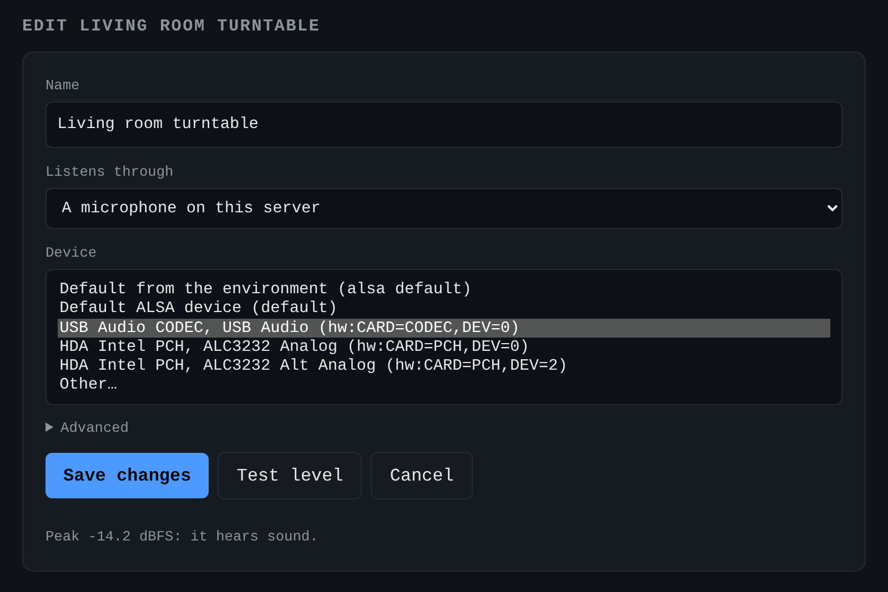
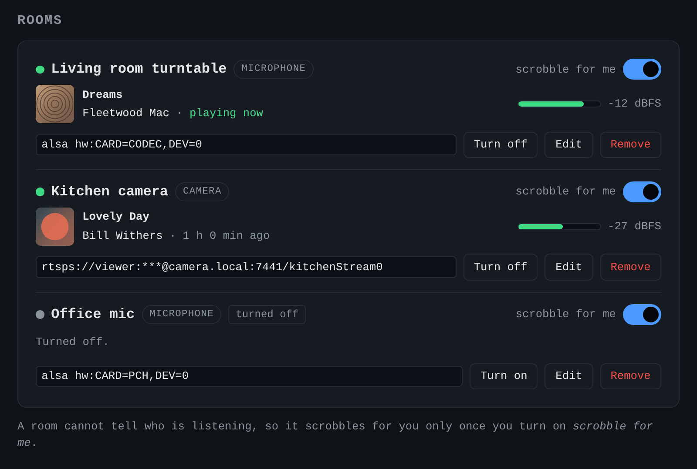
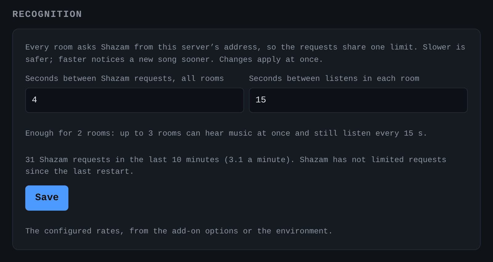
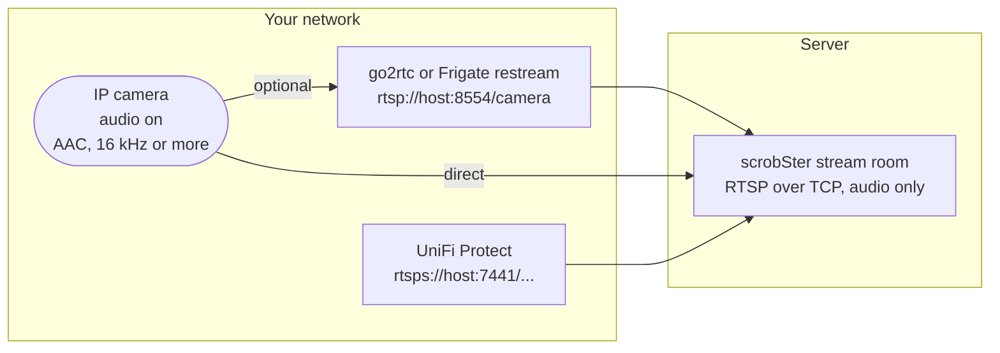
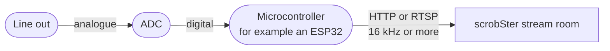
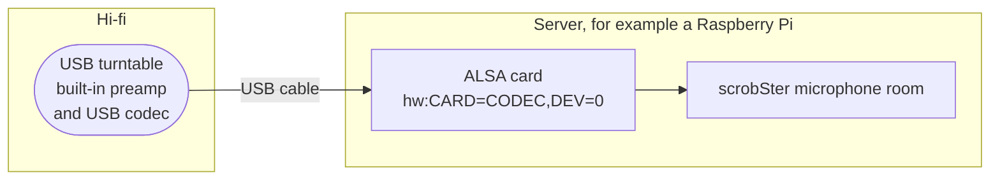
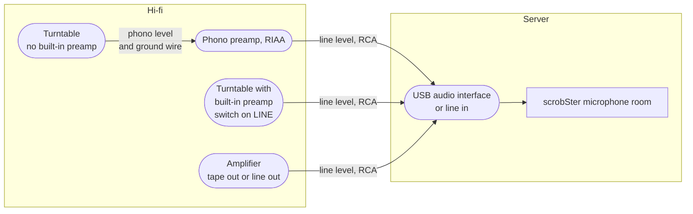
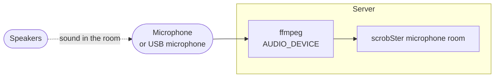
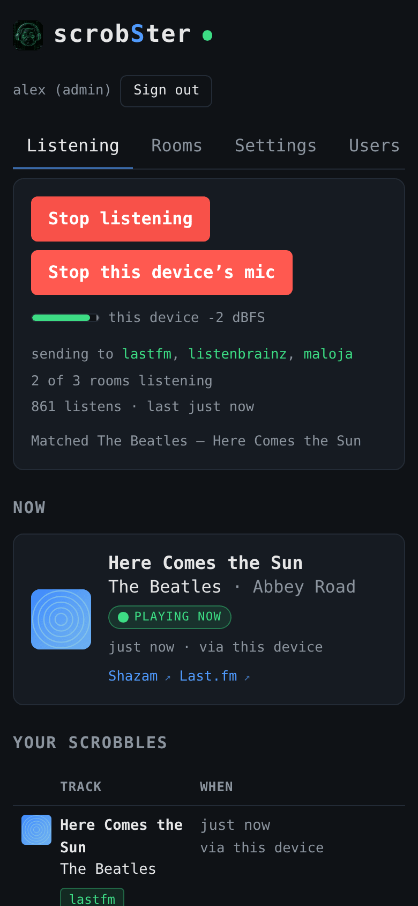
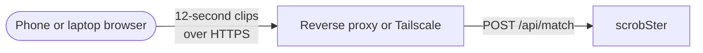

# Rooms and cameras

Rooms have their own tab. An administrator adds rooms there. Each room has a
name, which the history shows, and one input:

- **A microphone on this server.** Pick a device, or leave the default, which
  is `AUDIO_DEVICE`.
- **A camera or stream.** Give its URL: `rtsp://`, `rtsps://`, `http://` or
  `https://`. ffmpeg asks an RTSP camera for its audio only, over TCP, so the
  video is never sent.

**Test level** records three seconds and reports the peak, before you save. A
camera with its audio turned off says so.



Each room runs its own capture loop, and the Rooms tab shows each room's level
and what it hears, live. Every user turns on **scrobble for me** for the rooms
they want. A room scrobbles for nobody until then, except for the
administrator who added it. A song that two rooms hear at once is still one play for
someone who receives both.



An administrator also sees how often Shazam is asked, below the rooms:



A camera reaches its room directly, or through a restream:



Tips for cameras:

- **Turn the audio on**, in the camera and in the stream you use. A camera's
  low-resolution substream is fine if it carries audio.
- **Choose AAC at 16 kHz or more** where the camera offers it. G.711 at 8 kHz
  loses everything above 4 kHz, and Shazam's fingerprint uses up to about
  5.5 kHz, so it matches less often.
- **Use a restream** if you have one, for example go2rtc or Frigate at
  `rtsp://host:8554/<camera>`. Many cameras accept only a few connections.
- **UniFi Protect** shares an RTSPS URL per camera, on port 7441. Its
  self-signed certificate is accepted.
- **The camera password stays on the server.** The page shows it as `***`,
  and leaving `***` in place keeps it when you edit the URL. Errors are
  cleaned of it before anyone sees them.
- **Audio stays on your network.** Each clip lives in a temporary file. Only
  the fingerprint, computed locally, goes to Shazam.
- **Anything ffmpeg can read works**, not only cameras. A home-made device,
  for example a microcontroller that digitises a line-out, can serve its audio
  over HTTP or RTSP and be added as a stream. Send 16 kHz or more, for the
  reason above.

A home-made stream looks like this:



**A turntable with a USB output** is the best input for vinyl. It sends the
record as digital audio, with no microphone or room noise in between. Plug it
into the server and it appears as a sound card:

```sh
arecord -l
# card 1: CODEC [USB Audio CODEC], device 0: USB Audio [USB Audio]
```

Add a microphone room with that device, here `hw:1,0`, or pick it from the
list in the form. Use **Test level** while a record plays. Turntables send a
fixed level, so near -20 dB is typical, and anything near -91 dB means the
wrong card, or the turntable is set to its Bluetooth output. Card numbers can
change between boots when more than one USB audio device is connected. To
pin it, use the card's name instead, for example `hw:CARD=CODEC,DEV=0`.

The turntable is a sound card on the server, so no other hardware sits in between:



A turntable or hi-fi without USB needs a USB audio interface, or a line input, at line level:



Never plug a turntable without a preamp straight into a line input: its signal is far too quiet, and its bass is not corrected.

**A camera that goes offline is logged once.** The first failure logs a
warning with the reason, then the room retries quietly, more gently each time
up to once a minute. The log gets a reminder every 15 minutes while it lasts,
a line for each new reason, and one line when the room works again. Over MQTT
the room's **Problem** sensor is on meanwhile, for an automation that tells you.

**Shazam's rate limit is shared.** Every room asks from the same address, so
requests take turns: at most one per `RECOGNITION_GAP_SECONDS`, whatever the
number of rooms. A silent room asks nothing. A 429 pauses every room, from one
minute up to ten.

**A known song is not asked about again.** Once a room matches the same song
twice in a row, it stops asking Shazam until that song should end, and for at
most `SKIP_KNOWN_SECONDS`, 60 by default. The length comes from MusicBrainz,
through the ISRC that Shazam returns, and the room asks again a few seconds
before the end, so the next song is caught as it starts. A song changed half-way
is noticed within `SKIP_KNOWN_SECONDS`. Silence makes the room forget the song
at once. While music plays this saves most requests, so more rooms fit within
the rate limit. Set `SKIP_KNOWN_SECONDS=0` to ask every cycle.

An administrator tunes both rates under **Recognition** on the Rooms tab, and a
change applies at once. The card counts the requests of the last ten minutes,
says when Shazam last limited them, and warns when the rooms that are on would
want requests faster than the limit allows. A rate chosen there outranks
`RECOGNITION_GAP_SECONDS` and `MATCH_INTERVAL`, until **Back to the configured
rates**.

An upgrade from 0.2 keeps working as before. The microphone becomes the first
room, named "Server mic", with the device chosen in Settings. Everyone who
received the microphone receives that room. Rename it after the room it is in
with **Edit** on the Rooms tab.

## Find your audio device

The easy way: sign in as an administrator, open Rooms, and edit a room, or
add one. The form lists the devices ffmpeg can see, and **Test level** records
three seconds from the one you pick and reports the peak, so a silent device is
caught before you choose it. A room's own device outranks `AUDIO_DEVICE`. The
steps below do the same by hand.

Step 1. List the devices.

macOS:

```sh
ffmpeg -f avfoundation -list_devices true -i ""
# use the audio index, for example AUDIO_DEVICE=":1"
```

Linux:

```sh
arecord -l
# "card 1: CODEC [USB Audio CODEC], device 0" is AUDIO_DEVICE="hw:CARD=CODEC,DEV=0".
# Prefer the name to hw:1,0: card numbers can change when USB devices appear
# in another order at boot. AUDIO_DEVICE="default" also works.
```

Step 2. Confirm that the device hears sound. Do not skip this step. A silent
device captures a file of the correct size, so size alone proves nothing.

```sh
ffmpeg -f avfoundation -i ":1" -t 5 -ac 1 -ar 44100 /tmp/t.wav -y
ffmpeg -i /tmp/t.wav -af volumedetect -f null - 2>&1 | grep mean_volume
```

Play music, then read the result. A value near -91 dB is digital silence, and
that device is the wrong one. A value near -20 dB is good.

The Rooms tab shows each room's level while it listens, updated a few times a
second while the room records, and warns you when a room is silent.

Index 0 is not always the microphone. On a Mac with virtual audio software, index
0 is often a loopback device that stays silent until you route audio through it.

## Two ways to listen

**Server microphone (default).** The Python process records the host audio
device with ffmpeg. It runs headless, needs no browser, and survives a closed
tab. Use this for an always-on machine.

The microphone hears the speakers, and ffmpeg records it on the server:



**Browser microphone (optional).** Open the page and select *use this device's
mic*. Once the browser has permission, a menu next to the button lets you pick
which microphone, and the page remembers it. A live meter under the buttons
shows what that microphone hears, with a mark holding the loudest of the last
second, so you can aim a phone without waiting for a clip to be sent. The
browser records 12-second clips and posts them to `POST /api/match`.
The server identifies and scrobbles them through the same path, so both inputs
share one history and one duplicate filter. Use this for a phone or a laptop in
another room.



The browser asks for raw audio, because echo cancellation, noise suppression,
and automatic gain control remove the detail that Shazam needs.

The tab must stay open and awake. A phone stops recording when the screen
sleeps.

Browsers permit microphone access only in a secure context. `http://localhost`
works. A plain `http://` address on your network does not. To use a phone, put
the app behind HTTPS, for example with a reverse proxy or Tailscale.

A phone reaches the server like this:


