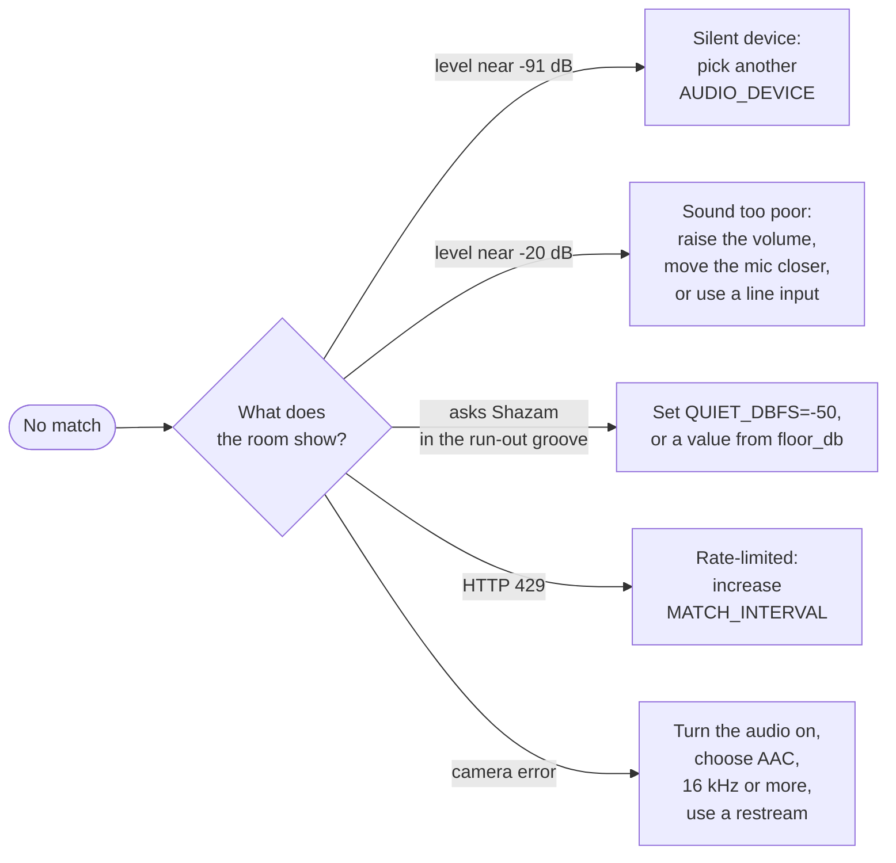

# Troubleshooting

Start from what the room shows:

**Every cycle returns no match.** Read the room's level on the Rooms tab.
The browser microphone has its own live meter.

- Near -91 dB: the device is silent. Pick a different `AUDIO_DEVICE`.
- Near -20 dB but still no match: the microphone hears the music, but the sound
  is too poor to identify. Raise the volume, or move the microphone closer.
- On macOS, set Control Center > Mic Mode to **Standard**. Voice Isolation
  removes everything except speech, and it destroys the fingerprint.

**A turntable keeps asking Shazam after the side ends.** The run-out groove
still sends surface noise, clicks and pops. Their peak is loud, so the room
does not count it as silence. Set `QUIET_DBFS=-50`. The room then compares the
clip's floor, its median level, which a click does not raise. A quiet clip asks
nothing and forgets the song, like silence. To pick your own value, read the
room's `floor_db` in `/api/status` with the needle in the run-out groove, and
again while music plays. Choose a value between the two, closer to the noise.
It is off by default, because quiet music through a distant microphone or a
camera can sit as low as a record's surface.

**To scrobble music that plays on this computer**, capture the output instead of
the microphone. Install a loopback device, for example
[Background Music](https://github.com/kyleneideck/BackgroundMusic) or
[BlackHole](https://github.com/ExistentialAudio/BlackHole). Set it as the system
output, then set `AUDIO_DEVICE` to its index. The audio stays digital, so the
match rate is much better than a microphone.

**Other problems.**

- `certificate verify failed` on macOS with a python.org build: run with `SSL_CERT_FILE=$(.venv/bin/python -m certifi)`.
- ffmpeg capture fails on macOS: give your terminal microphone permission in System Settings > Privacy & Security.
- HTTP 429 from Shazam: your IP is rate-limited. Increase `MATCH_INTERVAL`.

## Recognition limits (measured)

These numbers come from tests against known audio on this project. They explain
the defaults.

- **A longer window does not help. It breaks matching.** Windows of 8 to 14
  seconds matched. Windows of 16 and 20 seconds failed every time, although
  their fingerprints were larger. shazamio finds Shazam answers no match from
  15 seconds up, and matches best at 12, the window the Shazam apps send. So
  the fingerprint is always 12 seconds: the middle of a longer
  `CHUNK_SECONDS`, or a shorter chunk whole.
- **Shazam tolerates a lot of noise.** A known track still matched under heavy
  pink noise and strong artificial reverb, even when the noise was almost as
  loud as the music.
- **Level is what matters.** Matching failed only when the music sat about
  14 dB below the noise, or lower.

So a missed song usually means one of these:

- The sound at that moment was speech, not music.
- The music was very quiet or very distant.
- The recording is not in the Shazam database, for example a live version.
- Microphone processing changed the sound. See [Troubleshooting](#troubleshooting).

The listener skips the request when the input is silent, so silence costs no
API quota.
